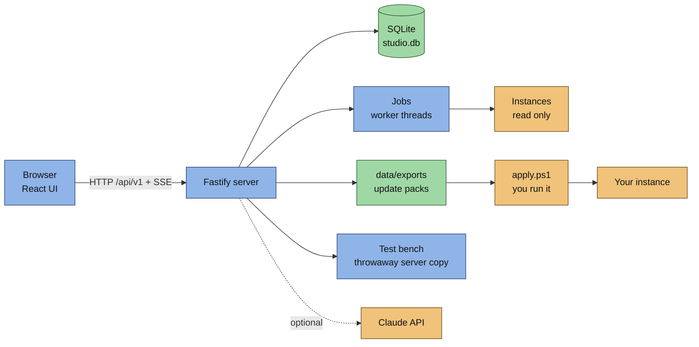
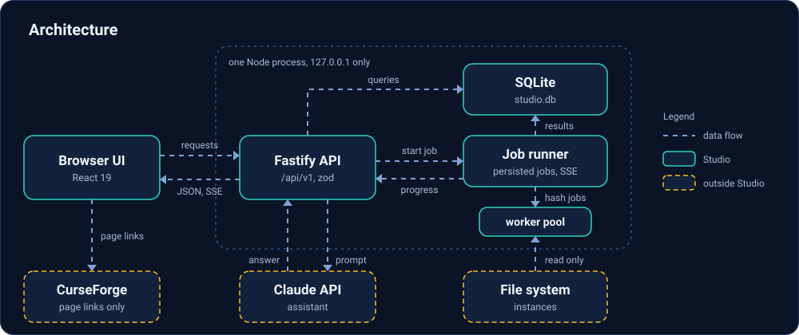
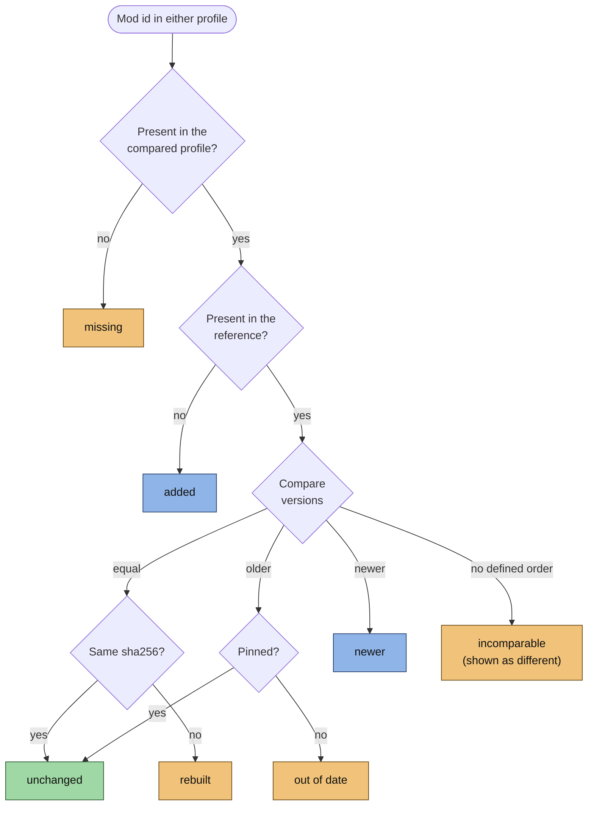

Created with [Claude Code](https://claude.com/claude-code)

<p align="center"></p>

# Modpack Studio

> This project (code, tests and documentation) is written by Claude Code, Anthropic's agentic coding tool, working with its maintainer. The documentation is kept up to date the same way, in the same commits as the code.

Modpack Studio is a self-hosted web app for people who maintain **their own Minecraft modpack on top of a base modpack** (typically a large CurseForge pack that ships new versions regularly). It compares mods and configs between copies of a pack, tells your changes apart from what the game regenerated, tests a throwaway server copy, and prepares an update pack that you apply yourself.

**It never writes into your instances.** It reads them and prepares packages. The full update cycle (detecting a base release, building candidates, the player and server packs, deployment, the announcement) is the direction of the project, not what exists today: see the status table below.

## Status

| Area | Available now | Planned |
|---|---|---|
| Profiles | Matrix of copies (clean, launched, played), immutable snapshots, import of folders, CurseForge instances and server pack zips | |
| Mods | Comparison by mod id with a reason per row, version ordering, derived server blacklist, decisions, anomalies, loader agreement | |
| Configs | Normalised comparison, three-copy "what did I change" analysis | Three-way merge for files changed on both sides |
| Update | Plan, export folder and zip, safe `apply.ps1` | Base-release detection, candidate build, full CurseForge and server packs |
| Tests | Headless server test bench with kept logs | Client test without a paid account |
| Claude | Five ready-made actions (API or copy-paste prompt) | |
| CurseForge | Links read from each instance's `minecraftinstance.json` | API client: fingerprints, newer files, changelogs |
| Delivery | | Update the played server, Discord announcement from the changelog |

Details and open items: [Roadmap](docs/roadmap.md).

## How it fits together

One Node.js process serves the web UI and a JSON API on `127.0.0.1`. Data lives in a local folder. The only network calls go to the Claude API, and only when you use an assistant action.



The update cycle the project is built around, with the parts that work today and the parts that are planned:

<p align="center"></p>

Stack, process model, jobs and the data folder are in [Architecture](docs/architecture.md).

<p align="center"></p>

## What it does

- **Compares mods** between any two profiles, by mod id and not by file name, with a plain-language reason for every row: missing, added, out of date, newer, rebuilt, incomparable.
- **Derives the server blacklist** from the base modpack's own client/server split and remembers your decisions (pin a version, accept a removal, force a side).
- **Compares configs** (`config`, `kubejs`, `defaultconfigs`, ...) and separates *what you changed* from *what the game regenerated*, using three copies of the pack.
- **Prepares update packs**: you pick mods and config files into a plan and get a folder, a zip and an `apply.ps1` (dry run by default, backs up before replacing, never deletes).
- **Tests a server** headlessly: starts a throwaway copy next to the real one, waits for `Done`, stops it, keeps the logs. There is no client test yet.
- **Asks Claude** ready-made questions about the lists, through the API or as a prompt you paste into claude.ai.
- **Reads CurseForge links** from each instance's `minecraftinstance.json` (no API key needed). If that file is unreadable during an import, the stored links are kept.

### Profile lifecycle

A profile is one copy of one pack at one version, on one side (client or server), in one state. Studio tracks the copies and their snapshots.

<p align="center"></p>

### Three copies

To know what you changed, Studio needs three copies of the same pack version. The states are declared by you; Studio checks them against each other and against the launch artifacts. See [Concepts](docs/concepts.md).

| State | Meaning |
|---|---|
| clean | Freshly installed from the pack, never started |
| launched | Started once, so the game has generated its files |
| played | The copy in real use, with your changes |

<p align="center"></p>

### How the mod comparison decides

Each mod id present in either profile ends in exactly one bucket. The comparison is `diffModSets` in `src/server/mods/diff.ts`; version ordering is in `src/shared`.



A pin only silences an intentional downgrade: a pinned mod whose version is incomparable stays visible. The comparison, plan and assistant routes refuse a client profile against a server profile with `400 sides_differ`, and the comparison refuses a profile without imported mods with `400 profile_not_imported`. Rules, sides and anomalies are in [Mod analysis](docs/mods-analysis.md).

## Two-minute test

Requirements: **Windows** with PowerShell, and **Node.js 24 or newer** (the launcher offers to install it with winget). The interface is in **French** today; code, logs and docs are in English.

Demo mode builds synthetic data in a temporary folder and starts on it. It touches nothing else.

```powershell
git clone <repository-url> modpack-studio
cd modpack-studio
Start.cmd            # choose 3 (Demo)
```

Then open `http://127.0.0.1:8481/` (the demo port) and sign in with the password `demo`. The launcher also opens the page by itself once the server answers.

Things to try, in the demo data:

1. **Profiles**: see the matrix of copies and their state.
2. **Mods**: pick a reference and a compared profile, read the reason on each row, open **Details** on one.
3. **Configs**: compare the three copies and look at the line diffs.
4. **Blacklist** and **Decisions**: see what was derived and what is remembered.

## Quick start

On your own data (port `8480`, folder `./data`):

```powershell
Start.cmd                                  # menu: setup, start, demo, password, build, tests, package, task
# or, non-interactive
pwsh -File studio.ps1 -Action setup        # install, build the UI, choose a password
pwsh -File studio.ps1 -Action start        # http://127.0.0.1:8480/
```

`setup` checks Node.js 24+, installs dependencies, builds the web UI and asks for a password. The server listens on `127.0.0.1` only. A different port can be set in `data/settings.json`.

First run, once signed in:

1. **Settings**: enter the names of the base modpack and of your modpack (defaults are `Base` and `Own`).
2. **Profiles**: add a profile for the base modpack and one for your modpack, then import each from a folder, a CurseForge instance or a server pack zip.
3. **Mods**: choose the two profiles and read the comparison.
4. Add decisions, build a plan, export an update pack.
5. Run `apply.ps1` from the export yourself, first as a dry run.

More in [Architecture](docs/architecture.md#running-it).

## Configuration

Everything a user may want to change is a setting, not code: pack names, assistant model and effort, thresholds, ports, folders. Open the **Settings** tab; values are stored in `data/preferences.json`, and the API key in a separate protected file. Where each value lives and how it is protected: [Settings](docs/settings.md).

Naming used in these docs:

| Term | Meaning | Code and settings name |
|---|---|---|
| Base modpack | The pack you follow | role `upstream` |
| Your modpack | The base plus your mods and settings | role `own` |

## The tabs

| Tab | Purpose |
|---|---|
| Profiles | Copies of each pack: version, side, state, location, import |
| Mods | Mod comparison, reasons, update plan, Claude buttons, per-row debug panel |
| Configs | "My changes" over three copies, or a free comparison of two profiles |
| Old pack | Pick an old pack and the base modpack, refresh CurseForge links, and run the Claude action "what is missing in the new base?" |
| Test bench | Throwaway server tests with kept logs and Claude analysis |
| Decisions | Everything Studio remembers for you, plus the audit log, jobs and system info |
| Blacklist | Mods kept off the server, derived from the base modpack plus your own |
| Settings | API keys, assistant model, the two pack names |

## Documentation

| Page | What it explains |
|---|---|
| [Concepts](docs/concepts.md) | Vocabulary, the two packs, profiles, the clean / launched / played states and how they are declared and checked |
| [Architecture](docs/architecture.md) | Stack, one-process design, database, jobs, data folder, running and packaging |
| [Mod analysis](docs/mods-analysis.md) | Jar import, comparison by mod id, version ordering, sides, blacklist, loader agreement |
| [Config analysis](docs/configs-analysis.md) | Inventory, normalisation, the three-copy "what did I change" logic |
| [Update packs](docs/update-pack.md) | The plan, the export folder, `apply.ps1` |
| [Test bench](docs/test-bench.md) | Throwaway server tests and their safety rules |
| [Claude assistant](docs/claude-assistant.md) | Settings, the five ready-made actions, API versus copy-paste prompt |
| [CurseForge](docs/curseforge.md) | What is used today, what comes next, why players stay on CurseForge |
| [Performance and parallelism](docs/performance.md) | What runs in parallel, why scans were slow, what fixed it |
| [Projects](docs/projects.md) | Validated retouches kept per release line, and the preview of replaying them on a new base version |
| [Release cycle](docs/release-cycle.md) | The full update cycle from a base release to the player announcement |
| [Settings](docs/settings.md) | Keys, preferences and pack names: where they live and how they are protected |
| [Security and guarantees](docs/security.md) | The rules that protect your instances and your secrets |
| [Roadmap](docs/roadmap.md) | What works and what is planned |

Older design records: [docs/plans](docs/plans).

## Roadmap

Planned work is listed in [docs/roadmap.md](docs/roadmap.md): base-release detection, candidate builds, full CurseForge and server packs, a client test, the CurseForge API client, deployment and the announcement message.

## Repository layout

```
src/server/   Fastify API, SQLite + Drizzle, jobs, mod and config analysis, test bench, Claude client
src/web/      React UI (strings in src/web/i18n, French today)
src/shared/   Schemas and the version ordering (imported by the server)
drizzle/      Database migrations
tests/        Vitest suites on synthetic fixtures only
scripts/      Packaging, logon task, demo data
docs/         Documentation, docs/assets for the diagrams, docs/plans for design records
studio.ps1    Interactive launcher (Start.cmd opens it)
```

## Development

```powershell
npm ci
npx tsc --noEmit                         # type check, must be clean
npx vitest run                           # synthetic fixtures only
npm run build:web
npx drizzle-kit generate --name <name>   # after editing src/server/db/schema.ts
```

Conventions: code, comments, commits and docs are in English; tests come first and never touch real instances; no secret is ever written to a committed file, a log or an API response. Details in [CLAUDE.md](CLAUDE.md). The docs describe the code as it is: a change that alters behaviour updates the matching page in the same commit.

## License

No license has been chosen yet. Until one is added, the source is visible but no right to copy, modify or redistribute it is granted.
