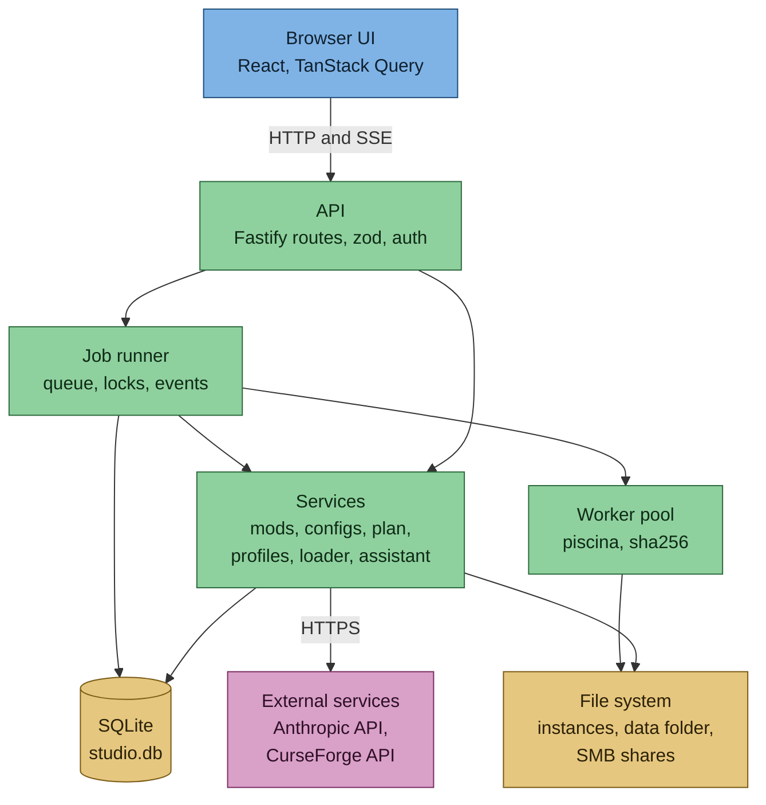
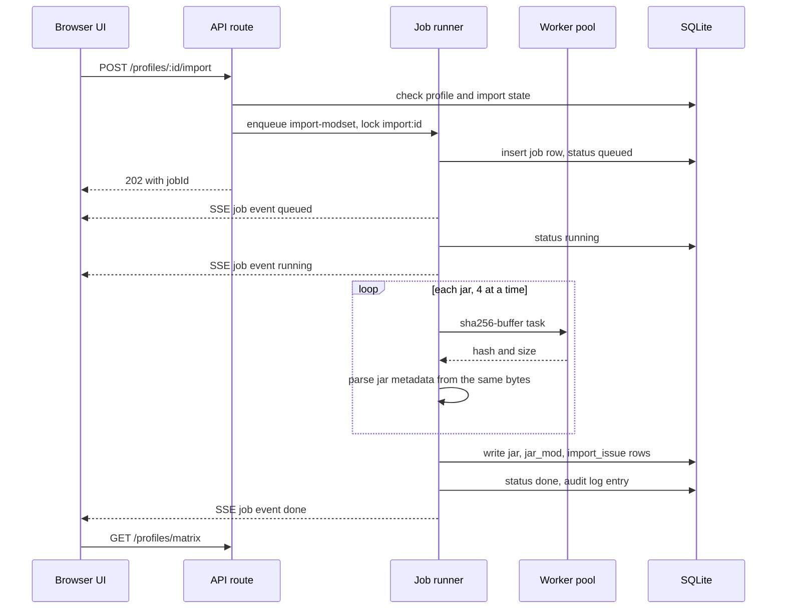
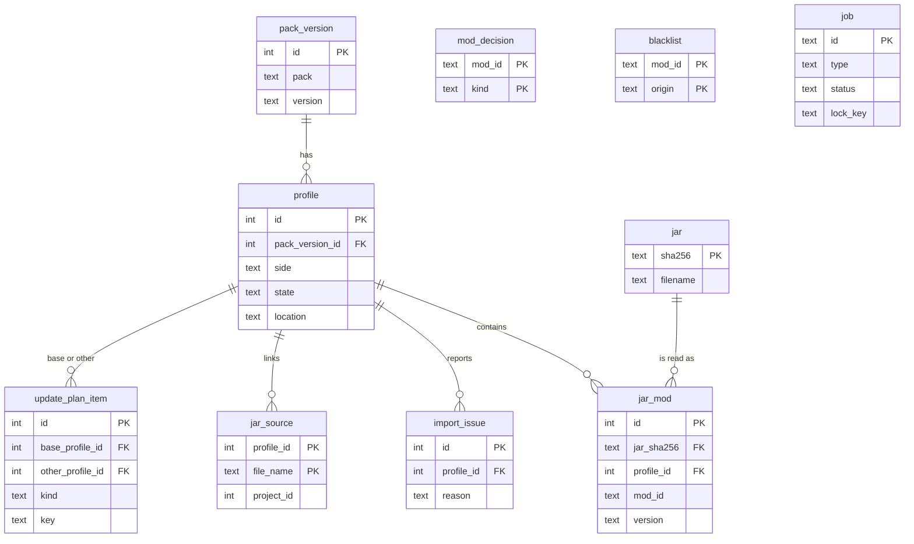

# Architecture

> Part of [Modpack Studio](../README.md) · created with Claude Code

**What this page covers:** the stack, the layers of the single process, the data folder, the database tables, how one import job flows, and how to run and package Studio.

<p align="center"></p>

## Stack and why

| Layer | Choice | Why |
|---|---|---|
| Language | TypeScript on Node.js (24 LTS target, developed on 25) | One language for the API, the jar/zip handling and the UI; types shared through `src/shared` |
| API | Fastify 5 + zod 4 | Schema-validated routes under `/api/v1`, cookie sessions, rate limiting on the login route only (5 per minute) |
| Database | SQLite (better-sqlite3) + Drizzle migrations | Single local file, no service to run, migrations in `drizzle/` |
| Parallel work | piscina worker threads | Hashing jars (sha256) off the main thread during imports |
| Archives | yauzl (read) / yazl (write) | Stream zips without extracting them |
| UI | React 19 + Vite + Tailwind 4 + TanStack Query/Virtual | Large tables stay smooth (virtualised), server state cached |
| AI | Official `@anthropic-ai/sdk` | Claude actions through the API ([details](claude-assistant.md)) |
| Tests | Vitest (synthetic fixtures only) | Never touches a real instance |
| Launcher | PowerShell + CMD (`Start.cmd`, `studio.ps1`) | Setup, start, demo, tests, packaging from one menu |

Exact versions are in `package.json` (ranges) and `package-lock.json` (pinned). Run `npm audit` for the current vulnerability state. An `overrides` entry pins a dev-only transitive `esbuild`.

## Layers

One request goes down these layers; slow work leaves the main thread through the job runner:



## One process, local by default

A single Node process serves the API and the built web UI on `127.0.0.1:8480`. By default it listens on loopback only and checks the `Host` and `Origin` headers. Exposing it on a network is opt-in through `settings.json` (`port`, `bindHost`, `lanIp`, `allowedHosts`, see [Settings](settings.md) and [Security](security.md)). With `lanIp` set, a second plain-HTTP listener binds that address and the address is accepted as a `Host`: the password and the session cookie then travel in clear on the LAN. If that listener fails to bind, Studio logs it and retries every 30 seconds. The demo mode serves on port 8481.

Everything Studio keeps lives in the **data folder** (`./data`, git-ignored):

| Path | Content |
|---|---|
| `studio.db` | SQLite: profiles, mods, decisions, plans, jobs, audit log |
| `backups/` | Rolling copies of `studio.db` (the last 5), taken at startup before migrations |
| `settings.json` | Password hash (scrypt) and server settings (`port`, `bindHost`, `lanIp`, `allowedHosts`) |
| `secrets.json` | API keys, write-only ([Settings](settings.md)) |
| `preferences.json` | Assistant model/effort and the two pack names |
| `cache/` | Config inventories (`configs-<profileId>.json`) |
| `exports/` | Generated update packs |
| `tests/` | Server test runs with their logs ([Test bench](test-bench.md)) |

A damaged `settings.json` stops the startup with a message naming the file; a damaged `preferences.json` or `secrets.json` makes saves fail with code `settings_unreadable` and leaves the file untouched. The database backup is skipped when the newest one is under one hour old, unless a migration is pending.

## Source layout

```
src/server/
  api/            Route files (routes-profiles, -mods, -configs, -plan, -decisions, -assistant, -testbench, -settings), events.ts (SSE), auth.ts
  db/             Drizzle schema, client, startup backup
  jobs/           Job runner (persisted queue, locks), piscina pool and worker
  mods/           Jar import, diff, blacklist, decisions, CurseForge sources, update pack builder
  configs/        Inventory scan and cache, normalisation, diff, customization analysis
  plan/           Plan store, plan keys, apply.ps1 template
  loader/         Loader and Minecraft version detection
  profiles/       Profile service (declared state, launch-artifact check)
  testbench/      Throwaway server tests
  assistant/      Claude client and prompts
  settings/       Keys, preferences, pack names
  fs-safe/        Path-escape guard
  zip/            Hardened zip reader
  cli/            set-password
  blobs/          Content-addressed store (only its own test uses it today)
  threadpool.ts   Warns when UV_THREADPOOL_SIZE is unset, imported first by main.ts
src/web/          Pages, components, API clients, i18n JSON per work stream
src/shared/       zod schemas and version ordering
```

`mods/side-classifier.ts` and `mods/modrinth.ts` exist with tests but are not wired into the running app (only tests use them): the sides actually used come from the base pack's server and client split plus your stored decisions.

## Jobs

Anything slow (import, scan, export, test) is a **job**: a database row with a status and progress, started by a `POST` that returns at once. The UI follows it through the Server-Sent Events stream (`/api/v1/events`, used by the Profiles page and the config scan) or by polling (export, test bench, jobs list). Jobs survive a refresh; on a restart, jobs that were `queued` or `running` are marked *interrupted*. Each job has one **lock key** (`import:<profileId>`, `configs:<profileId>`, `export:<base>:<other>`, `testbench`), so two jobs with the same key never run together while others do; an import and a scan of the same profile have different keys. The state machine is in [Concepts](concepts.md#jobs). An open event stream is re-checked at every event and every 15 seconds and is closed after logout or the 12 h session expiry.

One import, from click to result:



## Database

Schema in `src/server/db/schema.ts`; migrations `0000` to `0004` (initial, import issues, update plan, jar source, user origin). After editing the schema: `npx drizzle-kit generate --name <name>`. Jar bytes are never stored: only metadata and the sha256 are. Main tables (names and key columns only):



Tables without links are `mod_decision` (pin, ignore, side, keyed by mod id), `blacklist` (origin `atm_derived` or `user`), `job`, `setting`, `audit_log`, `event` and `blob`.

## Running it

```powershell
Start.cmd                                    # interactive menu
pwsh -File studio.ps1 -Action setup|start|demo|password|build|test|package|task
```

By hand:

```powershell
npm ci
npm run set-password          # asks twice, hidden on a terminal, writes data/settings.json
npm run build:web
$env:UV_THREADPOOL_SIZE = '32'   # must be set before node starts, the launchers do it
npm start                     # STUDIO_DATA=<dir> changes the data folder
```

`npm run dev:web` runs the Vite dev server with an API proxy. `npx tsx scripts/seed-demo.ts <dir>` builds throwaway synthetic data (password `demo`); it refuses a folder that is not new or marked `.studio-demo`. Node 24 is expected (`engines` in `package.json`).

## Packaging and logon task (Windows)

```powershell
pwsh scripts/package.ps1 [-Version 0.1.0] [-NodeExe <portable node.exe>]
pwsh scripts/install-task.ps1 -InstallDir D:\ModpackStudio          # dry run
pwsh scripts/install-task.ps1 -InstallDir D:\ModpackStudio -Apply   # logon task, current user
```

The package is `dist/modpack-studio-<version>.zip` plus a `.sha256`. Unpacked, it holds `versions/<version>/`, a `current` pointer, `start.cmd` (follows `current` at run time, so the logon task survives updates), `install-task.ps1` and a generated `run.cmd` that appends all output to `data\studio.log` (rotated above a size limit) and checks the Node major first. `data/` sits next to `versions/` and survives updates. A "Studio PC" is a machine that runs Studio all the time and reads the gaming PC or the server over SMB under the user's own account.

## Debug area

The **Decisions** tab also holds app facts (versions, data folder, database size, row counts; never the configuration or a secret), the audit log (search, paging, raw payload) and the jobs (status, progress, full error). Routes: `GET /debug/info`, `GET /debug/audit`, `GET /debug/jobs`.
