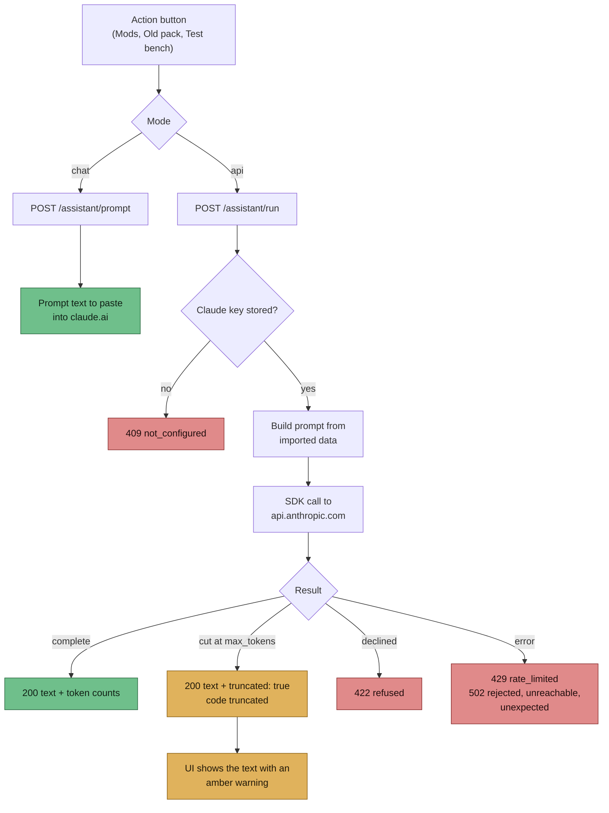

> Part of [Modpack Studio](../README.md) · created with Claude Code

# Claude assistant

What this page covers: the two ways Studio hands a question to Claude, the five ready-made actions, what the answer can look like when it is cut short, and the error codes the API returns. Keys and model choice live in [Settings](settings.md).

Studio can ask Claude to review the lists it produces. Two modes, chosen per click:

| Mode | How it works | Good for |
|---|---|---|
| **api** | Studio calls the Claude API through the official SDK with the key stored in Settings and shows the answer | One click, no copy-paste. The API has no internet access |
| **chat** | Studio builds the prompt and you paste it into claude.ai | Questions that need web search (mod changelogs, compatibility) |

## How a request flows

An action button sends a request to Studio. In chat mode the prompt comes back to you; in api mode Studio sends it to Anthropic and returns the answer, flagged when it was cut at the output limit.

The prompt is built on demand from Studio's data and **is not stored**. Only an `assistant.run` audit row is written (action, target, model, effort, token counts, truncated flag), never the prompt or the answer.

## Actions

| Action | Question it answers |
|---|---|
| `review-updates` | Are these mod updates worth applying? Anything risky? |
| `review-added` | Are the mods I added useful, redundant or abandoned? |
| `review-missing` | Why might these base mods be missing from my pack? |
| `migrate-old-pack` | What from my old pack is missing in the new base, and what replaces it? |
| `analyze-test-run` | Why did this server test fail, or what warns in its log? |

Buttons appear on the Mods, Old pack and Test bench tabs. Prompts come from `src/server/assistant/prompts.ts` (`buildPrompt`, `buildTestRunPrompt`). Pack names in prompts come from the two pack-name settings. The loader named in a prompt is the one detected on the reference pack (a CurseForge instance, a server zip or an unpacked server folder); when nothing can be detected the prompt says "mod loader".

The four pair actions work on two imported profiles of the same side. A client profile against a server profile is refused with `400 sides_differ`, and a profile with no imported mods gives `409 profiles_not_imported`. `analyze-test-run` works on one finished test run.

CurseForge links stored at import (see [CurseForge](curseforge.md)) are pasted into the prompt text as page links; that is the only place they are used.

## Limits in a prompt

| Limit | Value | Notes |
|---|---|---|
| Mod rows per prompt | 400 | Longer lists are cut and the prompt says so |
| Log lines (test run) | last 150 | |
| Crash report lines (test run) | first 120 | |
| Answer budget | 16000 tokens | Shared by thinking and visible text |
| Client timeout | 5 minutes | A timeout is reported as `unreachable` |

These are code constants today, not settings; see [Settings](settings.md#limits-that-are-still-code-constants).

## Behaviour

- Default model `claude-sonnet-5-5`, effort `medium`; both selectable in Settings.
- The SDK sends the key as `Authorization: Bearer`; the API version is chosen by the SDK. The base URL is fixed to the official API: `ANTHROPIC_BASE_URL` and `ANTHROPIC_AUTH_TOKEN` from the environment are ignored.
- No automatic retry: a slow paid call is never sent twice behind your back. Closing the page aborts the call.
- A refusal is reported with the code `refused`, never retried silently. No fallback model is enabled.
- An answer cut at the token limit is **kept**, returned with HTTP 200, `truncated: true` and `code: "truncated"`. The UI shows it with an amber "Reponse coupee" marker (French text in the app) because it may stop in the middle of the list. An empty answer is a `502 unexpected`.
- Keys are stored write-only ([Settings](settings.md)) and never logged. The audit log keeps only the last 4 characters of a key when it is saved.

## Error codes

| Code | HTTP | Meaning |
|---|---|---|
| `not_configured` | 409 | No Claude key stored |
| `profile_not_found`, `run_not_found` | 404 | Unknown profile or test run |
| `run_not_finished` | 409 | The test run has no result yet |
| `profiles_not_imported` | 409 | A profile of the pair has no imported mods |
| `sides_differ` | 400 | Client profile paired with a server profile |
| `refused` | 422 | The model declined the request |
| `rate_limited` | 429 | The API rate-limited the call |
| `rejected` | 502 | The API refused the key |
| `unreachable` | 502 | No connection, or the call timed out |
| `unexpected` | 502 | Any other API error or an empty answer |
| `truncated` | 200 | Answer cut at the output limit; text is included |

The web app maps errors by `code`. An error with no code, or an unknown one, shows the server message as is.

Source: `src/server/assistant/anthropic.ts` (client factory, `runPrompt`, `checkClaudeKey`), `routes-assistant.ts` (`GET /assistant/actions`, `POST /assistant/prompt`, `POST /assistant/run`, `POST /profiles/:id/sources`).
