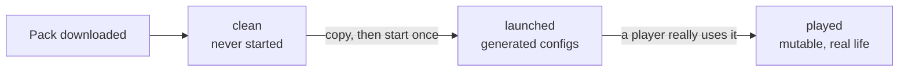

# Concepts

[← README](../README.md)

## The problem in one paragraph

You maintain a modpack that is a **base modpack plus your changes**. The base modpack releases new versions. For each release you must: take the new base, re-apply your mods and settings, update your own mods, test, build the player and server packages, publish, and announce. Doing that by hand means comparing hundreds of jars and thousands of config files. Studio automates the comparing and the preparing, and leaves every decision and every write to you.

## Vocabulary

| Term | Meaning |
|---|---|
| **Base modpack** (`<base-modpack>`) | The upstream pack you follow. Setting role `upstream` |
| **Your modpack** (`<base-modpack>` + `<your-modification>`) | Your derived pack. Setting role `own` |
| **Mod / jar** | A mod is a `.jar` file. Inside: its id, version, dependencies and declared side |
| **Mod id** | The stable internal name of a mod. The file name changes with every version, the id does not. Studio compares by id |
| **Loader** | The mod runtime (NeoForge, Forge, Fabric). A mod only works for one loader and one Minecraft version |
| **Config** | Setting files of the pack and of mods: `config`, `defaultconfigs`, `kubejs`, `scripts`, `datapacks`, `global_packs` |
| **Profile** | A record Studio keeps for one copy of a pack: pack, version, side, state and location |
| **Side** | `client` or `server`. Some mods are client-only (maps, UI), some server-only |
| **Plan** | The list of things you chose to push (mods to update, config files to keep). Selecting changes nothing |
| **Update pack** | A folder + zip + script containing only the difference to apply to an instance |
| **Job** | A long task (import, scan, test) that runs in the background with progress and can be cancelled |
| **SMB** | Windows file sharing, used to read an instance on another PC |

## Profiles: clean, launched, played

A profile is `(pack, version, side, state, location)` where the location is a folder or a zip. The **state** is the important part.

| State | What it is | How Studio treats it |
|---|---|---|
| `clean` | The pack exactly as shipped. Never started, no generated file | The "what the authors intended" reference. Immutable snapshot |
| `launched` | The clean pack started once: the game and the mods wrote their own config files | The "what the game regenerates by itself" reference. Immutable snapshot |
| `run` (played) | The instance really in use (client on a gaming PC, server on the host, read over SMB) | Mutable: it changes under your feet, so it is rescanned on every analysis |

**Studio does not detect the state.** You declare it when you create the profile. It only enforces two sanity checks:

1. **A clean profile must not have been used.** On creation, Studio looks for launch traces: non-empty `logs`, `crash-reports`, `world` or `saves`, `options.txt`, and `.bak` files at the root or in `config/` (the backups NeoForge writes when it rewrites a config). It ignores `instance_audit.txt`, which the CurseForge app creates by itself. A polluted clean is refused with the list of traces.
2. **No duplicates.** One profile per pack, version, side and state. A version therefore has at most one clean, one launched and one played per side. Old versions keep only their clean.

Immutable profiles (clean, launched) are imported once; re-importing is refused. A played profile can be imported again.

## Why three copies

Comparing *played* with *launched* tells you what you changed, without the noise of files the game rewrites by itself. Comparing *launched* with *clean* tells you what is generated rather than shipped. The combination is the key to the config analysis: see [Config analysis](configs-analysis.md#what-did-i-change-the-three-copy-logic).

## Loader and Minecraft version detection

- **CurseForge instance**: `minecraftinstance.json` holds the loader actually installed (`baseModLoader`), which can differ from the pack manifest. Studio trusts the installed one.
- **Server pack zip**: the start script and the installer. If they disagree on the loader version, Studio reports a conflict.
- **Agreement check**: every side must be on the same loader and Minecraft version. A missing Minecraft version is "unknown", not a mismatch.

Source: [`src/server/loader/detect-loader.ts`](../src/server/loader/detect-loader.ts), [`src/server/profiles/profile-service.ts`](../src/server/profiles/profile-service.ts).
