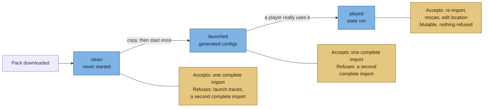
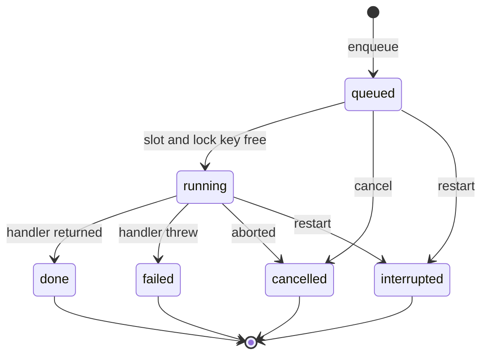

# Concepts

> Part of [Modpack Studio](../README.md) · created with Claude Code

**What this page covers:** the vocabulary, the three profile states (clean, launched, played), how jobs behave, and how the loader is detected.

## The problem in one paragraph

You maintain a modpack that is a **base modpack plus your changes**. The base modpack releases new versions. For each release you must: take the new base, re-apply your mods and settings, update your own mods, test, build the player and server packages, publish, and announce. Doing that by hand means comparing hundreds of jars and thousands of config files. Studio automates the comparing and the preparing, and leaves every decision and every write to you.

## Vocabulary

| Term | Meaning |
|---|---|
| **Base modpack** | The upstream pack you follow. Setting role `upstream` |
| **Your modpack** | Your derived pack. Setting role `own` |
| **Mod / jar** | A mod is a `.jar` file. Inside: its id, version and declared side |
| **Mod id** | The stable internal name of a mod. The file name changes with every version, the id does not. Studio compares by id |
| **Loader** | The mod runtime (NeoForge, Forge, Fabric). A mod only works for one loader and one Minecraft version |
| **Config** | Setting files of the pack and of mods: `config`, `defaultconfigs`, `kubejs`, `scripts`, `datapacks`, `global_packs` |
| **Profile** | A record Studio keeps for one copy of a pack: pack, version, side, state and location |
| **Reference / compared** | In a comparison of two profiles, the first is the reference (what you start from) and the second is the compared profile (the one the rows describe) |
| **Side** | `client` or `server`. Some mods are client-only (maps, UI), some server-only; a decision can also say `both` |
| **Plan** | The list of things you chose to push (mods to update, config files to keep). Selecting changes nothing |
| **Update pack** | A folder + zip + script containing only the difference to apply to an instance |
| **Job** | A long task (import, scan, export, test) that runs in the background with progress |
| **SMB** | Windows file sharing, used to read an instance on another PC |

## Profiles: clean, launched, played

A profile is `(pack, version, side, state, location)` where the location is a folder or a zip. The **state** is the important part.

The same lifecycle, with what each state accepts or refuses:

| State | What it is | How Studio treats it |
|---|---|---|
| `clean` | The pack exactly as shipped. Never started, no generated file | The "what the authors intended" reference. Immutable snapshot |
| `launched` | The clean pack started once: the game and the mods wrote their own config files | The "what the game regenerates by itself" reference. Immutable snapshot |
| `candidate` | Your custom test copy: the base plus your mods and your configs, started and played to check that additions and updates work, with a test server next to it. It is not the version you really use | Mutable like `run`. Give it its own version label (for example `test-1`). Use it to compare your configs before building the final pack |
| `run` (played) | The instance really in use (client on a gaming PC, server on the host, read over SMB) | Mutable: it changes under your feet, so a scan request always re-reads it (never answered from the cache). Diff and My changes use the **last scan** and never rescan: scan it again first when the player has edited files |

**Studio does not detect the state.** You declare it when you create the profile. It enforces these checks:

1. **A clean profile must not have been used.** For a clean profile whose location is a folder or an SMB path, Studio looks for launch traces: non-empty `logs`, `crash-reports`, `world` or `saves`, `options.txt`, and `.bak` files at the root or in `config/` (the backups NeoForge writes when it rewrites a config). It ignores `instance_audit.txt`, which the CurseForge app creates by itself. A polluted clean is refused (422) with the list of traces. The check runs on creation, when the location is edited and before an import. A clean zip is not inspected.
2. **The location must exist and be usable.** A relative or quoted path is refused (400, `location_not_absolute`); a missing path, or a file where a folder is expected (or the reverse), is refused (422, `location_not_found`, `location_wrong_kind`). The version is trimmed and limited to 64 characters.
3. **No duplicates.** One profile per pack, version, side and state (409). A version therefore has at most one clean, one launched and one played per side. "Old versions keep only their clean" is a convention, nothing enforces it.

Registering a played profile is not refused when a game process runs from its folder.

Immutable profiles (clean, launched) are imported until an import is **complete** (at least one mod and no skipped jar), so a retry after unreadable jars works. A complete import, or an import or scan already queued or running for the profile, answers 409. A played profile can be imported again at any time.

Profile actions on the Profiles page, with the routes behind them:

| Action | Route | Rules |
|---|---|---|
| Create | `POST /profiles` | Checks above. Kind `agent` is no longer accepted |
| Edit location | `PATCH /profiles/:id` `{location}` | Same validation as creation; works on immutable profiles and keeps imported data; 409 while an import or scan job runs |
| Delete | `DELETE /profiles/:id` | Removes its mods, import issues, jar sources, plan items and cached config inventory, then the profile and its pack version if unused. Shared jars and decisions stay. 409 while a job runs |

## Jobs

A **job** is a database row that follows this lifecycle (`src/server/jobs/runner.ts`):

At most 4 jobs run at once, and a job whose lock key is held waits in the queue. Only server tests can be cancelled from the UI ([Test bench](test-bench.md)); imports, scans and exports run to the end. A handler that returned is recorded `done` even if a cancel arrived too late to stop it. After a restart, jobs a dead process left `queued` or `running` become `interrupted`. More in [Architecture](architecture.md#jobs).

## Why three copies

Comparing *played* with *launched* tells you what you changed, without the noise of files the game rewrites by itself. Comparing *launched* with *clean* tells you what is generated rather than shipped. The combination is the key to the config analysis: see [Config analysis](configs-analysis.md#what-did-i-change-the-three-copy-logic).

## Loader and Minecraft version detection

- **CurseForge instance**: `minecraftinstance.json` holds the loader actually installed (`baseModLoader`), which can differ from the pack manifest. Studio trusts the installed one. Instances support NeoForge, Forge and Fabric.
- **Server pack zip**: the start script and the installer. If they disagree on the loader version, Studio reports a conflict. Zip detection only understands **NeoForge**.
- **Unpacked server folder**: the installer name, the `startserver` script and `libraries/net/neoforged/neoforge/<version>`. Also NeoForge only. When nothing readable is found the loader is "unknown", not an error.
- **Agreement check**: every side must be on the same loader and Minecraft version. A missing Minecraft version is "unknown", not a mismatch. `GET /loader/check` keys each profile as `<pack> <version> <side> <state>`, so clean, launched and played copies are all compared and a mismatch label names the state. The check is enforced when the server and client split of the base pack is derived (409) and on demand; `GET /mods/diff` does not run it.

## API errors

Routes answer `{ error, code? }`, including framework errors such as invalid JSON. Codes named in these docs are stable (`profile_not_found`, `location_not_absolute`, `sides_differ`, `profile_not_imported`, `profile_not_clean`, `triad_state`, ...). A pair of a client and a server profile is refused with 400 `sides_differ` by the mods diff, the plan routes and the assistant routes. A call made after the session expired answers 401 and the UI goes back to the login form.

Source: [`src/server/loader/detect-loader.ts`](../src/server/loader/detect-loader.ts), [`src/server/profiles/profile-service.ts`](../src/server/profiles/profile-service.ts), [`src/server/jobs/runner.ts`](../src/server/jobs/runner.ts).
