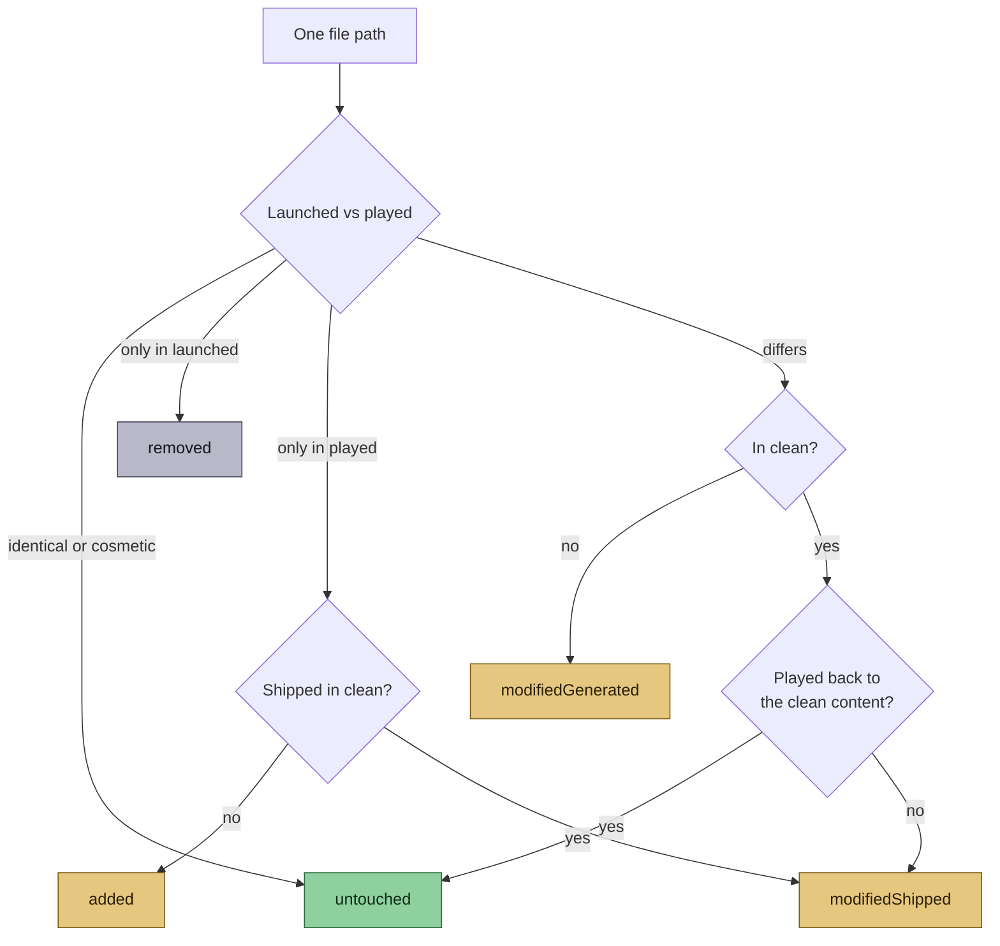

# Config analysis

> Part of [Modpack Studio](../README.md) · created with Claude Code · see also [Concepts](concepts.md)

**What this page covers:** how config files are scanned, how two profiles are diffed, and how three copies of a pack (clean, launched, played) tell you what you changed.

## What is tracked

Under each instance (folder, or server pack zip with or without a single wrapper folder): `config/`, `defaultconfigs/`, `kubejs/`, `scripts/`, `datapacks/`, `global_packs/`. A location that holds none of them (a mistyped parent folder, a zip with a stray top-level file next to the wrapper folder) fails the scan with that message and caches nothing. A missing location reports "location not found". Empty tracked folders scan fine.

## Inventory (scan)

Job `scan-configs` (`POST /configs/scan {profile, force?, deep?}`) lists every tracked file with size, sha256 and kind (text/binary).

- Ignored: `*.bak`, `*.tmp`, `*.log`, `Thumbs.db`, `.DS_Store`, `desktop.ini`, and any `logs/`, `cache/`, `.cache/` folder.
- Symlinks and junctions are never followed. Files above 5 MB are hashed only.
- Unreadable entries (path too long, locked, vanished) are listed as issues; the scan goes on.
- Result cached in `data/cache/configs-<profileId>.json`, with its scan date (`scannedAt`). Clean and launched profiles keep it until a forced rescan, or until a deep scan is requested and the cached scan was quick. A scan request on a played profile always re-reads it (never answered from the cache), because it changes under you.
- **Quick scan** (the default) stores known binaries (textures and the like) by size only: `sizeOnly`, with `sha256 = size:<bytes>`. **Deep scan** (`deep: true`, the deep-scan button) reads everything. Zip profiles are always read in full.

**Diff and My changes never rescan.** They use the last scan of each profile. After the player edits files, rescan the played profile first; `GET /configs/customizations` returns `scannedAt` for the clean, launched and played copies so you can see how old each one is.

## Diff between two profiles

`GET /configs/diff?base&other` gives per file (capped at 20000 files):

| Status | Meaning |
|---|---|
| identical | Same hash. Known binaries scanned quick are compared by size only, so equal size counts as identical (not byte-verified; a same-size edit is only detected when both sides are deep-scanned) |
| cosmetic | Bytes differ, settings do not (see below) |
| modified | Real difference |
| onlyInBase / onlyInOther | Present on one side only |
| binaryDiffers / tooLarge | Not diffed line by line |

The answer carries `sizeOnlyIdentical` (files declared identical on size alone) and each such file has `sizeOnly: true`; `GET /configs/inventory` returns `sizeOnlyFiles`. A quick-scanned profile compared with a deep-scanned folder or a zip therefore does not report byte-identical textures as changed.

What counts as cosmetic:

- Text: BOM, line endings, trailing spaces and tabs. A file that is not valid UTF-8 (Latin-1) is compared byte for byte apart from those. A trailing no-break space or similar Unicode blank is content.
- JSON, JSON5, JSONC and mcmeta: compared as key-sorted data, comments and trailing commas tolerated. JSON with an integer beyond 2^53 is compared as text, which loses key-order tolerance.
- TOML: comments, blank lines, indentation and spacing around `=` are ignored. The inside of multi-line strings and quoted key names are compared exactly, so an edit there is a real change.

Contents are read only for differing text files up to 1 MB. `GET /configs/file` shows one file (text up to 1 MB), `GET /configs/filediff` a hand-written Myers line diff (5000 lines per side, unified hunks). In the pair view, `PUT /configs/plan` selects modified or missing files for an update pack.

## What did I change? The three-copy logic

Comparing played against the base alone is noisy: the game and mods rewrite many configs at first launch. With three copies the noise cancels.

`analyzeCustomizations` (`src/server/configs/customizations.ts`) works in two steps: it diffs **launched** against **played**, then checks the files that look touched against **clean** to catch edits that were reverted:

A file that exists only when played but ships with the clean pack is also compared with clean first, and counts as `untouched` if it went back to the shipped content.

| Class | Rule | Action |
|---|---|---|
| untouched | played ≈ launched, or reverted to clean | Nothing |
| modifiedShipped | In clean, but played differs (also a shipped file the first launch removed and you edited) | Carry your edit over to the new version |
| modifiedGenerated | **Not** in clean, in launched, played differs | Generated by the game, then edited by you: **must be added to the pack** |
| added | Only in played, not in clean | Your own file: add it |
| removed | In launched, not in played | Reported, never copied |

Select the files to keep in the **My changes** view (`GET /configs/customizations`); the choice is stored as a plan on the pair (played, launched), kind `file` (`PUT /configs/customizations/plan`), and the export copies from the played profile ([Update packs](update-pack.md)). The launched profile is only the comparison reference of the exported pack: do not apply that pack to it.

Both routes answer 400 with a code when the trio is wrong: `triad_state` (a copy is not clean, launched or played), `triad_mismatch` (different pack, version or side) or `triad_distinct` (the same profile twice). A copy that was never scanned answers 409 `not_scanned`.

## Limits

Files are viewed, not edited. There is no three-way merge yet ([roadmap](roadmap.md)): nothing relates the old base to the new base, so a shipped file that changed in the new base *and* in your pack is not flagged. Compare the new base with the played profile in the pair view and judge each `modified` file by hand.
