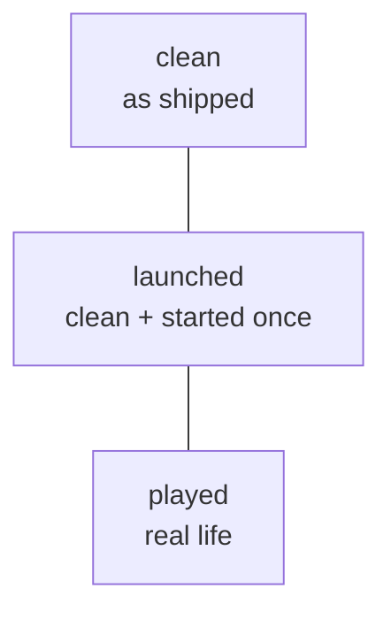

# Config analysis

[← README](../README.md) · [Concepts](concepts.md)

## What is tracked

Under each instance (folder, or server pack zip with or without a single wrapper folder): `config/`, `defaultconfigs/`, `kubejs/`, `scripts/`, `datapacks/`, `global_packs/`.

## Inventory (scan)

Job `scan-configs` (`POST /configs/scan {profile, force?}`) lists every tracked file with size, sha256 and kind (text/binary).

- Ignored: `*.bak`, `*.tmp`, `*.log`, `Thumbs.db`, `.DS_Store`, `desktop.ini`, and any `logs/`, `cache/`, `.cache/` folder.
- Symlinks and junctions are never followed. Files above 5 MB are hashed only.
- Unreadable entries (path too long, locked, vanished) are listed as issues; the scan goes on.
- Result cached in `data/cache/configs-<profileId>.json`. Clean and launched profiles keep it until a forced rescan; played profiles are rescanned every time.
- **Quick scan** compares known binaries by size only (`sizeOnly`); **deep scan** reads everything.

## Diff between two profiles

`GET /configs/diff?base&other` gives per file:

| Status | Meaning |
|---|---|
| identical | Same bytes |
| cosmetic | Bytes differ, settings do not (BOM, CRLF, trailing spaces; JSON/JSON5/mcmeta compared as key-sorted data with comments and trailing commas tolerated; TOML without comments, blank lines, indentation, spacing around `=`) |
| modified | Real difference |
| onlyInBase / onlyInOther | Present on one side only |
| binaryDiffers / tooLarge | Not diffed line by line |

Contents are read only for differing text files up to 1 MB. `GET /configs/file` shows one file (text up to 1 MB), `GET /configs/filediff` a hand-written Myers line diff (5000 lines per side, unified hunks).

## What did I change? The three-copy logic

Comparing played against the base alone is noisy: the game and mods rewrite many configs at first launch. With three copies the noise cancels:

For every file `analyzeCustomizations` (`src/server/configs/customizations.ts`) classifies it:

| Class | Rule | Action |
|---|---|---|
| untouched | played ≈ launched, or reverted to clean | Nothing |
| modifiedShipped | In clean, but played differs | Carry your edit over to the new version |
| modifiedGenerated | **Not** in clean, in launched, played differs | Generated by the game, then edited by you: **must be added to the pack** |
| added | Only in played | Your own file: add it |
| removed | In launched, not in played | Reported, never copied |

Select the files to keep in the **My changes** view (`GET /configs/customizations`); the choice is stored as a plan on the pair (played, launched), kind `file` (`PUT /configs/customizations/plan`), and the export copies from the played profile ([Update packs](update-pack.md)).

## Limits

Files are viewed, not edited. No three-way merge yet: a shipped file that changed in the new base *and* in your pack is flagged for manual review.
