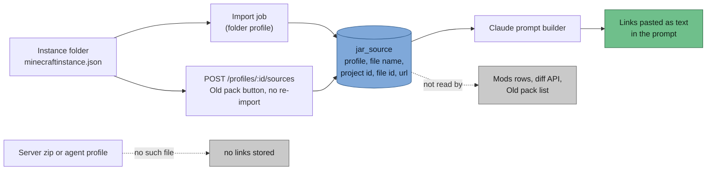
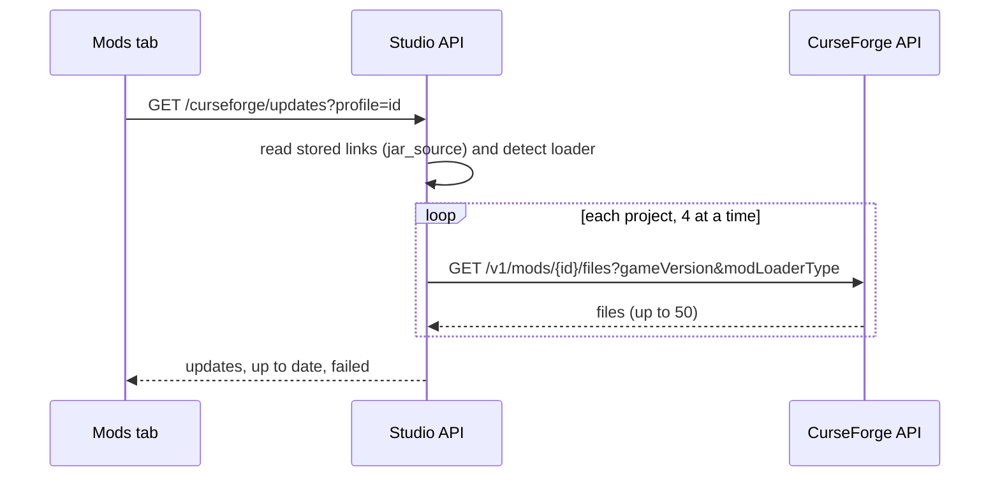

> Part of [Modpack Studio](../README.md) · created with Claude Code

# CurseForge

What this page covers: why distribution stays on CurseForge, what Studio reads from CurseForge instances (and where those links end up), the API client that looks up newer files, and what is still planned.

## Why players stay on CurseForge

Distribution stays on CurseForge: players already use its app, updates reach them without extra tooling, and your pack is published like the base one. A custom installer and launcher (packwiz on GitHub with a launcher such as Prism, or a launcher of your own) was researched and set aside: it would add maintenance, and a launcher with Microsoft login needs Mojang approval.

## Used today: links from instances

Each CurseForge instance holds `minecraftinstance.json`. For every installed addon it contains `addonID`, `installedFile.id`, `fileNameOnDisk` and `webSiteURL`. Studio reads them during import (`src/server/mods/curseforge-sources.ts`) and stores them in table `jar_source`, one row per profile and jar file name (migration `0003`). **No API key is needed.**

The page address from the file is kept only when it points at `https://www.curseforge.com/`; otherwise Studio builds `https://www.curseforge.com/projects/<addonID>`.

What the UI really does with them:

- **Mod rows, the diff API and the Old pack list still show no CurseForge link.** The links appear in two places: the [Claude assistant](claude-assistant.md) prompts (pasted as text, so Claude or you in chat mode can open the mod pages) and the "CurseForge updates" panel of the Mods tab (below).
- `GET /curseforge/sources?profile=<id>` returns the stored links of a profile.
- The Old pack tab has a button that re-reads `minecraftinstance.json` without re-importing the jars: `POST /profiles/:id/sources`. It works on instance folders only (`409 not_an_instance_folder` for a zip or agent profile), answers `409 instance_unreadable` (stored links unchanged) when the file cannot be read, and writes a `profile.sources` audit row with the count.
- If `minecraftinstance.json` is missing or unreadable during an import, the links already stored are kept and an import issue named `minecraftinstance.json` is recorded. One malformed addon entry does not discard the others.

## API client: newer files

Needs a CurseForge API key (header `x-api-key`, base `https://api.curseforge.com`) saved in Settings ([Settings](settings.md)). The key stays on the server; nothing returns it.

The Mods tab has a **CurseForge updates** panel for the "compared" profile. `GET /curseforge/updates?profile=<id>[&gameVersion=<mc>][&preRelease=1]` takes the mods of that profile that have a stored link, asks CurseForge for the files of each project (`GET /v1/mods/{id}/files`, filtered by the profile's Minecraft version and loader, first page of 50), keeps the newest release by file date (betas and alphas only when asked) and reports the ones newer than the installed file id.

| Answer | Meaning |
|---|---|
| `updates` | Mods with a newer file: project, link, installed file, latest file and date |
| `upToDate`, `checked` | Counts |
| `failed` | Projects CurseForge could not answer for (the others are still reported) |
| `noSources: true` | The profile has no CurseForge data (a server zip, or a folder that is not a CurseForge instance) |
| 409 `no_key` | No key saved |
| 502 `rejected`, 429 `rate_limited`, 502 `unreachable` | The key was refused, the rate limit was hit, CurseForge could not be reached; the check stops |

Settings keys: `curseforge.gameId` (default 432) and `curseforge.concurrency` (default 4 parallel requests).

What is confirmed and what is not:

- **Confirmed in the official documentation**: base URL and `x-api-key` header, `GET /v1/mods/{modId}/files` with `gameVersion`, `modLoaderType`, `index`, `pageSize` (50 maximum, `index + pageSize` at most 10000), `POST /v1/fingerprints/{gameId}` with its `exactMatches` answer, the loader numbers (1 Forge, 4 Fabric, 5 Quilt, 6 NeoForge) and release types (1 release, 2 beta, 3 alpha).
- **Confirmed from two community sources, not the official page**: the fingerprint is a 32-bit MurmurHash2 with seed 1 over the file bytes without tab, line feed, carriage return and space. Studio has this function (`fingerprint` in `src/server/mods/curseforge-api.ts`), cross-checked against an independent implementation, but it is not used yet.
- **Not confirmed**: the Minecraft game id (432 is the usual value, hence the setting) and how files with distribution disabled behave. Check both on the first real call.

## Planned

- Identify jars that have no link (a server zip, a hand-built folder) by fingerprint: needs the fingerprint stored per jar at import time.
- Show the stored links on the mod rows.
- Fetch changelogs for the release announcement, and the file and project ids for a CurseForge manifest.

See also the [release cycle](release-cycle.md) for where CurseForge publication fits.
