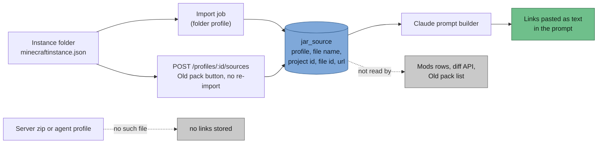

> Part of [Modpack Studio](../README.md) · created with Claude Code

# CurseForge

What this page covers: why distribution stays on CurseForge, what Studio reads from CurseForge instances today (and where those links end up), and what a CurseForge API client would add (planned, not built).

## Why players stay on CurseForge

Distribution stays on CurseForge: players already use its app, updates reach them without extra tooling, and your pack is published like the base one. A custom installer and launcher (packwiz on GitHub with a launcher such as Prism, or a launcher of your own) was researched and set aside: it would add maintenance, and a launcher with Microsoft login needs Mojang approval.

## Used today: links from instances

Each CurseForge instance holds `minecraftinstance.json`. For every installed addon it contains `addonID`, `installedFile.id`, `fileNameOnDisk` and `webSiteURL`. Studio reads them during import (`src/server/mods/curseforge-sources.ts`) and stores them in table `jar_source`, one row per profile and jar file name (migration `0003`). **No API key is needed.**

The page address from the file is kept only when it points at `https://www.curseforge.com/`; otherwise Studio builds `https://www.curseforge.com/projects/<addonID>`.

What the UI really does with them:

- **Mods page, diff API and Old pack list show no CurseForge link.** The links are not displayed on mod rows.
- The only consumer is the [Claude assistant](claude-assistant.md): the prompt builder reads `jar_source` and pastes the links into the prompt text, so Claude (or you, in chat mode) can open the mod pages.
- The Old pack tab has a button that re-reads `minecraftinstance.json` without re-importing the jars: `POST /profiles/:id/sources`. It works on instance folders only (`409 not_an_instance_folder` for a zip or agent profile), answers `409 instance_unreadable` (stored links unchanged) when the file cannot be read, and writes a `profile.sources` audit row with the count.
- If `minecraftinstance.json` is missing or unreadable during an import, the links already stored are kept and an import issue named `minecraftinstance.json` is recorded. One malformed addon entry does not discard the others.

## Planned: API client

Needs a CurseForge API key (header `x-api-key`, base `https://api.curseforge.com`), entered in Settings ([Settings](settings.md)). Today the key can be stored and tested (a request to `/v1/games`) and nothing else uses it. Planned uses:

- Identify unknown jars by fingerprint (`POST /v1/fingerprints/{gameId}`).
- List newer files of a mod (`GET /v1/mods/{id}/files`, filtered by loader; NeoForge has its own `modLoaderType`).
- Fetch changelogs for the release announcement.
- Show the stored links on the mod rows (planned).

Not confirmed yet: the fingerprint algorithm, the Minecraft game id and how files with distribution disabled behave. These will be verified against the official documentation before any code is written. See [roadmap](roadmap.md).

See also the [release cycle](release-cycle.md) for where CurseForge publication fits.
