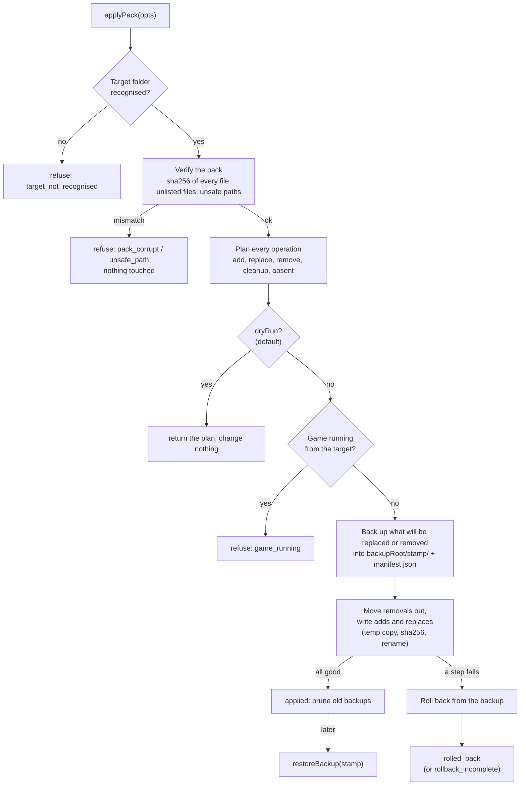

# Deploy: the apply engine

> Part of [Modpack Studio](../README.md) · created with Claude Code

**What this page covers:** the TypeScript engine that applies an [update pack](update-pack.md) to a server or instance folder from inside Studio (`src/server/deploy/`), what it guarantees, what it refuses, and how backups and restores work.

The engine is the building block for a future server deployment (stop the server, back up, apply, restart). **That full chain is the next brick and is not built here**: nothing calls the engine yet, there is no route, no button, no Discord message, no MCSS stop or start, and no handling of conflicts with a live server. This page only describes the engine.

`apply.ps1`, shipped inside every pack, is unchanged and stays the way to apply a pack on a machine that has no Studio. The engine follows the same safety model so both give the same result.

## The flow



## What the engine guarantees

- **Dry run by default.** `dryRun` is `true` unless the caller says otherwise. A dry run verifies the pack, plans, reports `gameRunning`, and changes nothing (it does not even create the backup folder).
- **Verify before touching anything.** The sha256 (and the size, when declared) of every file in `mods-add/` and `files-add/` is checked against `changes.json` first. A mismatch, a missing file, a file the pack holds but `changes.json` does not list, or a non-regular file aborts with `pack_corrupt` and no change.
- **Back up, then change.** Every file about to be replaced, and every file or folder about to be removed, is first copied into `<backupRoot>/<UTC stamp>/` keeping its path relative to the target. Only files the apply touches are backed up, never the world, logs or anything else.
- **Remove means move to the backup.** A removed jar or folder leaves the target only once its complete copy sits in the backup. Nothing the pack or the caller names is deleted outright.
- **Atomic-looking writes.** A new or replaced file is copied to `<name>.studio-tmp` next to its destination, hashed, then renamed over it. A half-written file is never left under its real name.
- **Rollback.** If any step fails, everything already done is restored from the backup and the result is `rolled_back` with the cause. The target ends byte-identical to how it started. The files the failed run had written are *set aside* inside the backup folder (`_set-aside/`), not deleted. If the rollback itself cannot restore a path, the result is `rollback_incomplete` with `rollbackErrors`, and the originals are still in the backup folder.
- **Refuses while the game runs.** `isRunning(targetDir)` (default `isProcessRunningFrom`) must say no for an apply. If it throws, the apply is refused (`process_check_failed`): not knowing is not "not running".

The only things the engine ever deletes are old backup folders beyond `keepBackups` and its own temporary `.studio-tmp` copies.

## What it refuses

| Code | When |
|---|---|
| `target_not_recognised` | The target is not an absolute path, does not exist, is a drive or share root, or holds none of `mods`, `config`, `libraries`, `run.bat`, `run.sh`, `server.properties`, `user_jvm_args.txt` |
| `pack_invalid` | `changes.json` is missing or unreadable |
| `pack_corrupt` | sha256 or size mismatch, file missing, file not listed in `changes.json`, a path listed twice |
| `unsafe_path` | A path from `changes.json`, `remove.txt`, `extraRemovals` or a backup manifest is absolute, has a drive letter, colon, backslash, UNC form, `.`/`..`/empty segment, or reaches outside the target through a symlink or junction |
| `path_conflict` | A folder or link is in the way of a file to write, `remove.txt` names something that is not a file, an `extraRemovals` entry is a link or overlaps a pack file or the backup folder |
| `game_running` / `process_check_failed` | See above |
| `backup_invalid` | `backupRoot` is not absolute or contains the target |

Refusals throw an `ApplyError` (alias of `DeployError`) with a `code` and a `details` list; the target is untouched. `remove.txt` names are plain jar file names relative to `mods/`. `extraRemovals` entries need at least two path segments, so a top-level folder such as `world` or `mods` cannot be named.

## Options and result

```ts
applyPack({
  packDir,          // the folder buildUpdatePack wrote (mods-add/, files-add/, remove.txt, changes.json)
  targetDir,        // the server or instance folder
  dryRun,           // default true
  backupRoot,       // where the stamped backup folders go
  keepBackups,      // default: limit deploy.keepBackups (2), range 1 to 20
  isRunning,        // (dir) => boolean | Promise<boolean>
  now,              // Date or () => Date, for tests
  extraRemovals,    // relative paths to move to the backup, e.g. the old NeoForge folder
  log,              // (message) => void
});
```

It resolves with:

```ts
{
  status: 'dry_run' | 'applied' | 'rolled_back' | 'rollback_incomplete',
  packName, plan: PlanOp[], counts: { add, replace, remove, cleanup, absent },
  gameRunning: boolean | null,
  backup: { stamp, dir } | null,   // null for a dry run
  prunedBackups: string[],         // stamps of old backups deleted
  cause?, rollbackErrors?,
}
// PlanOp = { kind: 'add' | 'replace' | 'remove' | 'cleanup' | 'absent', path, source?, sha256?, size? }
```

`kind` is `add` for a new file, `replace` for an existing file that will be overwritten, `remove` for a jar named in `remove.txt`, `cleanup` for an `extraRemovals` entry, and `absent` for something named for removal that is not there (nothing to do, as with `apply.ps1`). Paths are relative to the target, with forward slashes.

## Backups and restore

Each apply creates `<backupRoot>/<UTC stamp>/` (`YYYYMMDD-HHMMSS`, with `-2`, `-3`… if two backups share a second). It holds the old content at the original relative paths, plus `manifest.json`:

```json
{ "format": 1, "stamp": "20260304-050607", "createdAt": "...", "packName": "...",
  "status": "applied", "replaced": ["mods/a.jar"], "removed": ["mods/b.jar"], "added": ["mods/c.jar"] }
```

The manifest is written before the first change with status `in_progress`, so a crash still leaves a restorable record. Status is then `applied`, `rolled_back` (the run failed and the target was restored) or `restored`.

- `listBackups(backupRoot)`: the stamp-named folders, newest first, with status and counts.
- `pruneBackups(backupRoot, keep)`: deletes the oldest beyond `keep` (at least 1). It touches only direct child folders whose name matches the stamp pattern; any other folder or file in `backupRoot` is left alone. Backups with status `rolled_back` hold nothing and are always dropped first. An apply prunes after it succeeds, so a failed run never costs a good backup.
- `restoreBackup(backupRoot, stamp, targetDir)`: puts every backed-up file back and sets aside what the apply had added or replaced (in `<backup>/_set-aside/`). The backup stays complete, so a restore can be repeated. It checks the target is recognised and the game is not running (`opts.isRunning`, default `isProcessRunningFrom`). Folders created for added files are not removed.

`deploy.keepBackups` is a limit, editable in Settings, "Deploy" group (once the module is loaded by the server, which the next brick does).

## NeoForge cleanup

After a NeoForge upgrade the old version stays in `libraries/net/neoforged/neoforge/<version>/` (server jar, `unix_args.txt`, `win_args.txt`). `neoforge-cleanup.ts` names it so the caller can pass it as `extraRemovals`; the engine then moves it to the backup like any other removal.

- `planNeoForgeCleanup(targetDir, oldVersion, newVersion)` returns `["libraries/net/neoforged/neoforge/<oldVersion>"]` **only** when the versions differ **and** that folder exists. Equal versions, or an old folder that is not there, give `[]`. Both versions must match `^[0-9A-Za-z.+_-]{1,40}$` and start with a letter or digit (so `..` is refused) before any path is built.
- `detectInstalledNeoForge(targetDir)` returns the installed version: the one `run.bat`, `run.sh` or `user_jvm_args.txt` point at when that folder exists, else the single version folder; `null` when it cannot tell (it never guesses between several).

World data, config and mods are never part of the cleanup.

## Not built yet

The chain around the engine: stopping and restarting the server (MCSS), the Discord messages, dealing with conflicts against the live server (files changed on the server since the pack was built), the route and the UI. The engine is tested with synthetic folders only.
