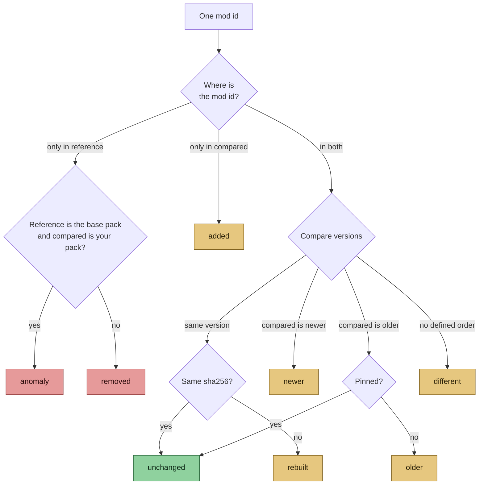

# Mod analysis

> Part of [Modpack Studio](../README.md) · created with Claude Code · see also [Concepts](concepts.md)

**What this page covers:** how mods are imported, how one mod is classified between two profiles, how versions are ordered, and how sides, the server blacklist and anomalies work.

## Import

A profile's mods come from a **folder instance** (`mods/`), a **CurseForge instance** or a **server pack zip**. Each jar is read once: its bytes are hashed (sha256, in a worker thread) and parsed from the same buffer, up to 4 jars at a time. Studio stores per jar: mod id, version, declared side, a jar-in-jar flag, a library key, sha256 and size. Jar bytes are never stored. Dependencies are not stored; they are only scanned for platform entries to infer the declared side, and the loader is not stored per mod.

What is reported and where:

| Case | Where you see it |
|---|---|
| Jar whose mod metadata exists but cannot be read (broken `fabric.mod.json`, `mods.toml` without a mod id, `quilt.mod.json` or `mcmod.info` only) | Import issue (skipped jar). The jar is not stored and one such jar never aborts the import. Shown in the import message, in 409 answers and in the blockers |
| Duplicate mod id in one profile | Import message, the Details panel and the blockers |
| Library (a jar that is not a mod) | Stored with a library key and left out of comparisons, shown nowhere |
| `minecraftinstance.json` unreadable | Import issue `minecraftinstance.json`; the CurseForge links already stored are kept |

Zip imports and the update-pack reader accept what the config scan accepts (case-colliding names, large entry counts), and zip entry names without the UTF-8 flag are decoded as CP437. See [Performance](performance.md).

## Comparison by mod id

Two profiles are compared by **mod id**, not by file name. The first profile is the **reference**, the second the **compared** one. Each row gets one status and a plain-language reason, because version numbers are already shown beside it.

The decision for one mod, in the order the code applies it (`diffModSets` in `src/server/mods/diff.ts`, then the Mods page):

| Status | Meaning |
|---|---|
| anomaly | In the reference, absent from your pack, when the reference is the base pack and the compared one is your pack (the player does not remove base mods) |
| removed | In the reference, absent from the compared profile, for any other pair |
| added | Only in the compared profile |
| older | Compared profile has an older version (the page says "out of date") |
| newer | Compared profile has a newer version |
| different | Versions have no defined order, so Studio does not guess. Plannable, and a pin does not silence it |
| rebuilt | Same version, different file (different sha256) |

A pin only silences `older`. Hovering a badge explains it. Each row has a **Details** panel (`GET /mods/:modId/debug`): both entries, why the versions order that way, decisions, plan state, duplicate ids, and a fresh sha256 of the reference jar, with a JSON copy button.

`GET /mods/diff` answers 400 `sides_differ` for a client against a server profile and 400 `profile_not_imported` when either profile has no imported mods, instead of a misleading diff.

## Version ordering

Maven-like, in `src/shared/versions.ts`, with project rules. The order is transitive. Examples taken from `tests/unit/versions.test.ts` (first version relative to the second):

| Rule | First | Second | Result |
|---|---|---|---|
| Numeric segments compare as numbers | `1.2.10` | `1.2.9` | newer |
| Known qualifiers have an order | `1.0-rc1` | `1.0-beta2` | newer |
| Pre-release before release | `1.0-beta` | `1.0` | older |
| Lone trailing letter is a patch letter | `2.5.4b` | `2.5.4` | newer |
| `a`, `b`, `m` mean alpha/beta/milestone only when glued to a digit | `1.0b1` | `1.0` | older |
| Zero segments are inert next to a qualifier | `1.0-beta1` | `1.0.0-beta1` | equal |
| Zero segments are inert next to a qualifier | `2.5.4b` | `2.5.4.0` | newer |
| Aliases of the release | `1.0-final` | `1.0.0` | equal |
| Leading `v` before a digit is a prefix | `v1.2.3` | `1.2.3` | equal |
| `v` not followed by a digit is a qualifier | `ver1` | `1` | older |
| Unknown word against a release | `1.2.3-pre1` | `1.2.3` | incomparable |
| Unknown word against a known qualifier | `1.2.3-dev` | `1.2.3-rc1` | incomparable |
| Same unknown word on both sides still orders | `1.0-dev2` | `1.0-dev1` | newer |
| Two different unknown words | `1.0-foo` | `1.0-bar` | incomparable |
| Commit hashes, including git describe | `1.2.3+g1a2b3c4` | `1.2.3+g9a2b3c4` | incomparable |
| Exact big numbers, no precision loss | `1.9007199254740993` | `1.9007199254740992` | newer |
| Empty or `${...}` placeholder | `${file.jarVersion}` | `1.0` | incomparable |

An incomparable pair becomes the `different` status, with a note in the Details panel such as "Token N: X and Y have no defined order (an unknown qualifier may be a pre-release, a patch or a platform tag)". A date with a patch letter (`20241231a`) stays incomparable on purpose, as the safe failure.

## Sides and the server blacklist

Modpack authors publish a client pack and a server pack. **Base client mods minus base server mods = client-only mods**, and those are kept off your server. This is the **derived blacklist**. It is computed live by `GET /mods/upstream-sides` and **stored** when you press "adopt" (`PUT /blacklist` with `adopt-upstream`): rows with origin `upstream_derived` are tagged with the base pack version they were derived for, and `GET /blacklist` flags them *stale* once the base version changes, so adopt again after each base release. Adopting needs both base profiles to be state `clean`, imported without a skipped jar, on the same pack version, loader and Minecraft version; otherwise the answer is 400 `profile_not_clean` or 409 (for example `upstream_version_mismatch`). Your own rows (origin `user`) always show, even for a mod that is also base-derived. You add decisions on top:

| Decision | Effect |
|---|---|
| side | Force a mod to client-only, server or both |
| pin | Keep an older version; silences only the `older` status |
| ignore / accept removal | A base mod you deliberately removed stops raising an anomaly |

Decisions are remembered with an editable reason (500 characters at most) and can be undone (Decisions tab); every change is in the audit log. Mod ids are 1 to 100 characters, a new decision refuses blank ids or ids with leading or trailing spaces, and `pin` or `ignore` with a side is a 400.

## Anomalies

A **base mod missing from your pack** is an anomaly until you accept it. `GET /build/blockers` lists three blocker codes: `ANOMALY`, `DUPLICATE_ID` (inherited from the base pack or in your own) and `SKIPPED_JAR`. There is no build step yet (candidate builds are on the [roadmap](roadmap.md)) and the update-pack export does not consult the blockers, so today they are informational. Loader and Minecraft version should agree across profiles ([Concepts](concepts.md#loader-and-minecraft-version-detection)); the check is on demand, `GET /mods/diff` does not run it.

## Old pack migration

The **Old pack** tab is a Claude action, not a comparison screen. Import the older pack first in the Profiles tab and register it as a profile of your pack. In the tab, pick the base profile and the old pack profile, optionally refresh the CurseForge links, then run the "old pack against base" prompt (needs an API key) or copy it into claude.ai. The shared count, the candidates (with CurseForge links when known) and both loaders only exist inside that prompt; Studio shows no table there ([Claude assistant](claude-assistant.md)).

Source: `src/server/mods/` (`diff.ts`, `blacklist-service.ts`, `decisions-service.ts`, `import-modset.ts`) and `src/shared/versions.ts`.
