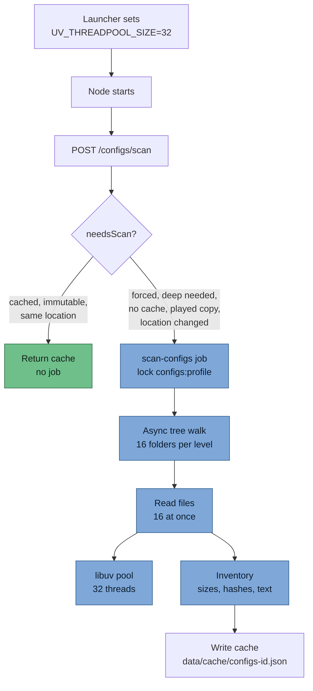

> Part of [Modpack Studio](../README.md) · created with Claude Code · see also [Architecture](architecture.md)

# Performance and parallelism

What this page covers: which kind of work runs on which thread or pool, why config scans over a synced drive were slow, what fixed it, and what you must do for the fix to apply.

## What runs where

| Work | Mechanism |
|---|---|
| Request handling, orchestration | Node event loop (one thread) |
| File system calls | libuv thread pool, raised from 4 to **32** threads by the launcher (`UV_THREADPOOL_SIZE=32`) |
| Hashing jars (sha256) | piscina worker threads. Each jar is read once, hashed once in the pool and parsed from the same bytes, for folder and zip imports. Up to 4 jars at a time |
| Config scan | Async: up to 16 files read at once for the whole scan, and up to 16 folders listed at once per tree level. Zip server packs are read sequentially |
| Diff reading | Concurrency 8 |
| Jobs | Up to 4 at once. Lock keys are per job kind (`import:<profile>`, `configs:<profile>`, `export:<base>:<other>`, `testbench`): two jobs with the same key never run together, but an import and a config scan of the same profile can |

`UV_THREADPOOL_SIZE` must be set before Node starts: setting it from code is too late (measured: no effect). Only the launchers raise the pool (`studio.ps1`, and the `run.cmd` of the packaged build). `npm start` or `npm run dev:server` alone run with the 4-thread default, which is the slow case described below. `src/server/threadpool.ts` is imported first in `main.ts` and only prints a warning when the variable is unset; it does not change anything.

## Lesson: the bottleneck was latency, not CPU

Config instances live on a synced network drive. Listing one `kubejs` folder cold took about 100 s, so a full scan took roughly 282 s and sat at 39 % for a long time. The CPU was idle. Fix: issue many reads and listings concurrently, raise the thread pool, and cache inventories.

| | Before | After |
|---|---|---|
| Full config scan, network drive | about 282 s | about 10 s |
| Concurrency | 4 file system threads, sequential listings | 32 threads, 16 files and 16 folders at once |
| Repeat scan of a clean or launched profile | full scan again | free, served from the cache |

## Scan pipeline

A scan request goes through the cache check first; only a real scan uses the thread pool and the concurrent reads.

Jar hashing is separate: an import job reads each jar once and sends the bytes to the piscina worker pool (`sha256-buffer` task) while the main thread parses them.

## Practical rules

- Prefer a quick scan for a first look (known binaries compared by size only); run a deep scan when you need certainty.
- A scan request always re-reads a played profile, because it changes under you. The analysis screens (diff, My changes) use the last scan and never rescan; they show when each copy was scanned.
- Clean and launched profiles are cached until a forced rescan or a location change. Deleting a profile removes its cache file.
- If a job shows "session expired", log in again: sessions are in memory with a 12 hour lifetime, and a restart ends them (jobs in flight are marked interrupted).
- Start Studio through the launcher; if the console prints the `UV_THREADPOOL_SIZE is not set` warning, scans over a synced drive will be slow.
