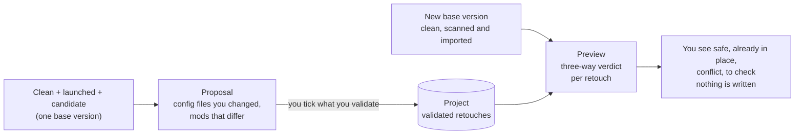

> Part of [Modpack Studio](../README.md) · created with Claude Code

# Projects

What this page covers: how Studio keeps the retouches you validated on your own pack (a "project", for example "My pack 2026") and shows, before anything is written, what replaying them on a new version of the base pack would do.

## Why a project

You test your changes by hand on a **candidate** (the custom test copy: the base plus your mods and your configs, see [Concepts](concepts.md#profiles-clean-launched-played)). Once validated, those changes should not be rebuilt from memory at the next base release. A project is a record in Studio's database that keeps them, independent of the base version.

## What is stored

| Kept | How |
|---|---|
| A config file you changed or added | Its content goes to the blob store (`data/blobs`, content-addressed), so replaying never depends on the old instance. The identity (hash, size) of the base's file at that moment is kept for the three-way check |
| A mod you added, replaced or removed | Mod id, your version, the base version at that moment, your file name and, when the candidate is a CurseForge instance, the project and file ids |

Jar bytes are not copied: only the identity of the mod. Validating the same file or mod again replaces its entry. The tables are `project` and `project_change` (migration 0007).

## The preview: three-way verdict

For each retouch, Studio compares three things: the base as it was when you validated, the new base, and your version.

| Base then / base now / yours | Verdict | Reason |
|---|---|---|
| Same / same / yours edited | **safe** | `base-unchanged`: the base did not touch it, replay your edit |
| Any / equal to yours | **already** | `same-as-mine`: the new base already holds your version |
| Different / different / yours edited | **conflict** | `base-changed`: the base changed the file you had edited |
| Your file, absent from the base then / absent now | **safe** | `new-file`: nothing to merge |
| Your file, absent then / the base now ships a different one | **conflict** | `base-now-ships-it` |
| Edited file, absent from the new base | **warning** | `base-removed` |

Mods follow the same logic with versions: an added mod is safe unless the new base ships it (same version: already; another version: conflict); a replaced mod is safe while the base kept its version, a conflict when the base moved it (`base-updated`), a warning when the base dropped it; a removal applies while the base still ships the mod.

Binary files that were only compared by size (quick scan on one side) are compared by size, never against a real hash.

Needs: the new base must be **scanned** (Configs tab) for files and **imported** (Profiles tab) for mods; otherwise the preview says which one is missing. Giving the previous clean version also shows what the base itself changed (mods added, removed, updated).

## Using it

Tab **Projects**: create the project, pick the three copies (clean, launched, candidate or run) and press "See my retouches", tick what you validate, then at the next base release pick the new clean version and "See the preview".

| API | Effect |
|---|---|
| `GET /projects`, `POST /projects` `{name}` | List, create (409 `duplicate_project` for the same name) |
| `GET /projects/:id` | Project and validated retouches |
| `GET /projects/:id/proposal?clean=&launched=&candidate=` | What could be validated; 400 `triad_state` or `triad_mismatch` for wrong copies |
| `POST /projects/:id/changes` `{clean, launched, candidate, files, mods}` | Validate; 400 `unknown_change` for something that is not a retouch of the candidate |
| `DELETE /projects/:id/changes/:changeId` | Remove one retouch |
| `GET /projects/:id/preview?newClean=&oldClean=` | The verdicts; 409 `not_scanned` is not raised, the answer lists what is `missing` |

## Not built yet

- Applying the preview: exporting the **safe** items as an update pack, with a choice per conflict (yours, the base's, merge).
- Key-by-key comparison, so that two edits in different keys of one file are not a conflict, and an editor ([roadmap](roadmap.md)).
- Reading the client's logs after a test run.

Source: `src/server/projects/` (`replay.ts` for the verdicts, `service.ts` for storage and preview) and `src/server/api/routes-projects.ts`.
