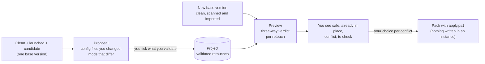

> Part of [Modpack Studio](../README.md) · created with Claude Code

# Projects

What this page covers: how Studio keeps the retouches you validated on your own pack (a "project", for example "My pack 2026") and shows, before anything is written, what replaying them on a new version of the base pack would do.

## Why a project

You test your changes by hand on a **candidate** (the custom test copy: the base plus your mods and your configs, see [Concepts](concepts.md#profiles-clean-launched-played)). Once validated, those changes should not be rebuilt from memory at the next base release. A project is a record in Studio's database that keeps them, independent of the base version.

## What is stored

| Kept | How |
|---|---|
| A config file you changed or added | Its content goes to the blob store (`data/blobs`, content-addressed), so replaying never depends on the old instance. The identity (hash, size) of the base's file at that moment is kept for the three-way check |
| A mod you added, replaced or removed | Mod id, your version, the base version at that moment, your file name and, when the candidate is a CurseForge instance, the project and file ids |

Jar bytes are not copied at validation: only the identity of the mod (plus the candidate it came from and the jar's sha256). The export reads the jar from that candidate. Validating the same file or mod again replaces its entry. The tables are `project`, `project_change` (migration 0007) and `project_choice` (migration 0008).

## The preview: three-way verdict

For each retouch, Studio compares three things: the base as it was when you validated, the new base, and your version.

| Base then / base now / yours | Verdict | Reason |
|---|---|---|
| Same / same / yours edited | **safe** | `base-unchanged`: the base did not touch it, replay your edit |
| Any / equal to yours | **already** | `same-as-mine`: the new base already holds your version |
| Different / different / yours edited | **conflict** | `base-changed`: the base changed the file you had edited |
| Your file, absent from the base then / absent now | **safe** | `new-file`: nothing to merge |
| Your file, absent then / the base now ships a different one | **conflict** | `base-now-ships-it` |
| Edited file, absent from the new base | **warning** | `base-removed` |

Mods follow the same logic with versions: an added mod is safe unless the new base ships it (same version: already; another version: conflict); a replaced mod is safe while the base kept its version, a conflict when the base moved it (`base-updated`), a warning when the base dropped it; a removal applies while the base still ships the mod.

Binary files that were only compared by size (quick scan on one side) are compared by size, never against a real hash.

Needs: the new base must be **scanned** (Configs tab) for files and **imported** (Profiles tab) for mods; otherwise the preview says which one is missing. Giving the previous clean version also shows what the base itself changed (mods added, removed, updated).

## Using it

Tab **Projects**: create the project, pick the three copies (clean, launched, candidate or run) and press "See my retouches", tick what you validate, then at the next base release pick the new clean version and "See the preview".

| API | Effect |
|---|---|
| `GET /projects`, `POST /projects` `{name}` | List, create (409 `duplicate_project` for the same name) |
| `GET /projects/:id` | Project and validated retouches |
| `GET /projects/:id/proposal?clean=&launched=&candidate=` | What could be validated; 400 `triad_state` or `triad_mismatch` for wrong copies |
| `POST /projects/:id/changes` `{clean, launched, candidate, files, mods}` | Validate; 400 `unknown_change` for something that is not a retouch of the candidate |
| `DELETE /projects/:id/changes/:changeId` | Remove one retouch |
| `GET /projects/:id/preview?newClean=&oldClean=` | The verdicts, each item with its current `choice`; 409 `not_scanned` is not raised, the answer lists what is `missing` |
| `PUT /projects/:id/choices` `{newClean, choices: {"<kind>:<key>": "mine"\|"base"\|"skip"}}` | Store choices for one new base version (survive a reload); answers with the updated preview; 400 `unknown_change` for a key that is not a retouch |
| `POST /projects/:id/export` `{newClean, target?, candidate?}` | Build the pack; answers `{name, folder, zip, result}`. 409 `not_scanned`, 409 `not_imported`, 400 `choice_missing` (lists the retouches without a choice), 409 `nothing_to_export` |

## Applying the preview: export a pack

Studio never writes into an instance, so applying the preview produces a **pack** in `data/exports/`, in the same layout and with the same `apply.ps1` as the [update pack](update-pack.md) (dry run by default, sha256 check of every file first, replaced or removed files are moved to a backup folder, nothing is deleted). The download route of the update packs serves it too.

Each previewed retouch has a **choice**:

| Choice | Effect in the pack |
|---|---|
| `mine` | Replay your version: a config file goes to `files-add/` (content from the blob store); a mod you added or replaced goes to `mods-add/` (jar read from the candidate you validated on, sha256 checked) and the new base's jar of that mod goes to `remove.txt`; a mod you removed goes to `remove.txt` |
| `base` | Keep the new base's file or mod, drop your retouch for this version |
| `skip` | Leave it out of the pack |

Defaults: **safe** items are `mine`, **already** items need nothing, **conflict** and **warning** items have no default, and the export is refused (400 `choice_missing`) until each has a choice. Choices are stored per project and per new base version (table `project_choice`), so they survive a page reload; a safe item can be overridden the same way.

`remove.txt` names the file the target really has (a renamed jar is found by size then content, as in the update pack). The target is optional: give any profile (typically the copy you will apply the pack to); without one, names are checked against the new clean copy and a warning says so. A mod whose jar is no longer in the candidate (or changed since validation) is not exported, and nothing is removed for it: it is listed in `CHANGES.md`, `changes.json` and the response (`failures`, `missingJars`).

The pack holds `CHANGES.md` and `changes.json` naming the project, the new base version and each item with its verdict, choice and outcome (`replayed`, `removed`, `kept-base`, `skipped`, `nothing`, `missing`), plus the sha256 of every file. On the page, each conflict or warning row has three buttons (keep my version, keep the base's, ignore), a counter shows how many retouches still need a choice, and "Export the pack" is enabled when none is missing; the result shows the folder, the zip, and how to run `apply.ps1`.

## Not built yet

- Key-by-key comparison, so that two edits in different keys of one file are not a conflict (a key-level merge could later resolve conflicts automatically), and an editor ([roadmap](roadmap.md)).
- Reading the client's logs after a test run.

Source: `src/server/projects/` (`replay.ts` for the verdicts and choices, `service.ts` for storage, preview and choices, `export.ts` for the pack) and `src/server/api/routes-projects.ts`.
