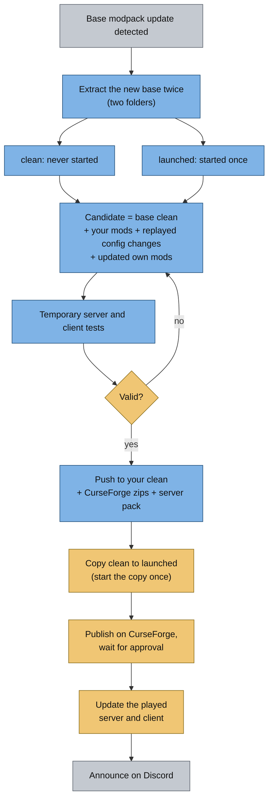

# Release cycle

> Part of [Modpack Studio](../README.md) · created with Claude Code · [Roadmap](roadmap.md)

**What this page covers:** the target workflow when the base modpack publishes a new version, and which steps Studio supports today.

The flowchart below shows the cycle. Blue steps exist today (fully or in part), amber steps are done by you outside Studio, grey steps are planned.

## Steps

1. **Detect** a new base version (planned).
2. **Extract the base twice.** The *clean* copy is never started. Only the second copy is started once to become *launched* ([Concepts](concepts.md)). Studio imports both as profiles; the extraction itself is done by you.
3. **Build the candidate**: base clean + your mods + your config changes replayed ([Config analysis](configs-analysis.md)) + your own mods updated ([Mod analysis](mods-analysis.md)). The comparisons and the update plan exist today; an automated build is planned.
4. **Test** on throwaway copies: server today ([Test bench](test-bench.md)), client planned.
5. **Validate** (you decide), then push the result to your clean profile and produce the CurseForge zips and the server pack. Update packs exist today ([Update packs](update-pack.md)); the full CurseForge zips and the server pack builder are planned.
6. **Copy clean to launched** and start the copy once, so the reference pair for the next cycle exists. Done by you.
7. **Publish** on CurseForge and wait for the approval. Done by you.
8. **Update the played copies**: the server (through your panel) and the client (through the CurseForge app). Done by you.
9. **Announce** on Discord: the changelog comes from CurseForge plus your own changes, sent through a webhook entered in Settings. The server's Discord mod keeps its token encrypted and its webhooks empty, so Studio needs its own webhook (planned).

Nothing here pushes, publishes or posts by itself: each outward step waits for your explicit action.
