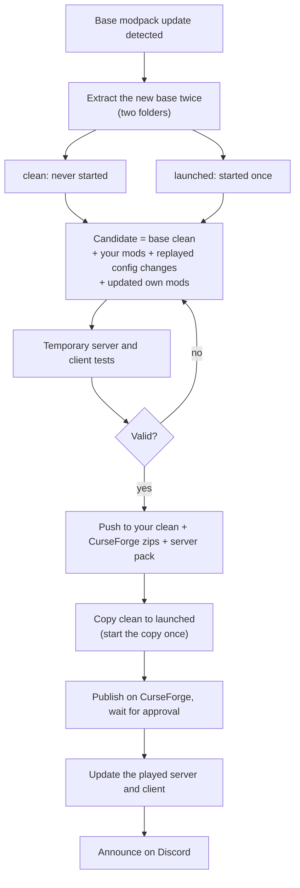

# Release cycle

[← README](../README.md) · [Roadmap](roadmap.md)

The target workflow when the base modpack publishes a new version. Steps marked ✅ exist today, the others are planned.

## Steps

1. **Detect** a new base version (planned).
2. **Extract the base twice.** The *clean* copy is never started. Only the second copy is started once to become *launched* ([Concepts](concepts.md)).
3. **Build the candidate**: base clean + your mods + your config changes replayed ([Config analysis](configs-analysis.md)) + your own mods updated ([Mod analysis](mods-analysis.md)). Compare ✅; automated build planned.
4. **Test** on throwaway copies: server ✅ ([Test bench](test-bench.md)), client planned.
5. **Validate** (you decide), then push the result to your clean profile and produce the CurseForge zips and the server pack (planned; update packs ✅, [Update packs](update-pack.md)).
6. **Copy clean to launched** and start the copy once, so the reference pair for the next cycle exists.
7. **Publish** on CurseForge and wait for the approval.
8. **Update the played copies**: the server (through your panel) and the client (through the CurseForge app).
9. **Announce** on Discord: the changelog comes from CurseForge plus your own changes, sent through a webhook entered in Settings. The server's Discord mod keeps its token encrypted and its webhooks empty, so Studio needs its own webhook (planned).

Nothing here pushes, publishes or posts by itself: each outward step waits for your explicit action.
