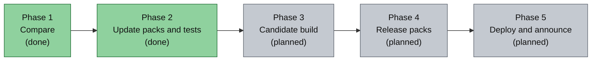

# Roadmap

> Part of [Modpack Studio](../README.md) · created with Claude Code

**What this page covers:** what Studio does today and what is planned, with the phases of the [release cycle](release-cycle.md) they belong to.

The chart groups the work in phases, from what exists to what is planned.

## Status

No item is in progress at the moment.

| Item | Status |
|---|---|
| Profiles matrix, immutable snapshots, launch-artifact check, import of folders, CurseForge instances and server pack zips | done |
| Mod comparison with reasons, version ordering, blacklist, decisions, anomalies, loader agreement | done |
| Refusal of client against server pairs in diff, plan and assistant routes (400 `sides_differ`) | done |
| Loader detection for unpacked server folders, stored CurseForge links kept when `minecraftinstance.json` is unreadable | done |
| Config comparison, normalisation, three-copy customization analysis | done |
| Update plan, export folder and zip, safe `apply.ps1` with rollback ([Update packs](update-pack.md)) | done |
| Server test bench with kept logs and result ([Test bench](test-bench.md)) | done |
| Claude actions (API and copy-paste), settings (keys, model, pack names, 21 tunable limits, lists and patterns) | done |
| CurseForge links read from instances | done |
| Base-release detection | planned |
| Candidate build: base clean + your mods + replayed config changes | planned |
| Copy clean to launched | planned |
| Full CurseForge zips and server pack builder | planned |
| Client test without a paid account (spike: launcher choice and offline accounts) | planned |
| CurseForge API client: fingerprints, newer files, changelogs ([CurseForge](curseforge.md)) | planned |
| Side detection from jar metadata and Modrinth: the code exists but is not wired into the comparison yet | planned |
| Update the played server and push it to the host panel | planned |
| Discord message from the changelog, through a webhook set in Settings | planned |
| Three-way merge for files changed on both sides | planned |

## Open questions

Tracked privately by the maintainer; the answers end up here and in the docs they change.
