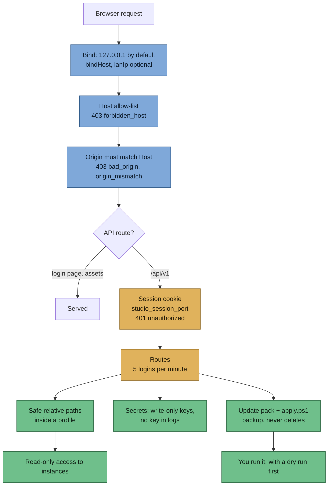

> Part of [Modpack Studio](../README.md) · created with Claude Code

# Security and guarantees

What this page covers: the protections around your instances and your secrets, layer by layer, and what each one does and does not guarantee. Studio is a local tool for one person; it is not hardened for exposure to the internet.

## Layers

A request must pass the network layer, the host and origin checks and the session before it reaches a route; routes then use safe paths, and nothing is ever written into an instance.

## Your instances

- Studio **reads** instances; it never writes into one. Changes leave as an [update pack](update-pack.md) that you apply yourself with `apply.ps1`.
- `apply.ps1` is a dry run by default and verifies the sha256 of every file of the pack before anything moves. With `-Apply` it moves replaced and removed files to `_studio-backup-<timestamp>` inside the instance, then copies the new files, and **never deletes**. If a step fails it rolls back; if the rollback cannot restore a file it says which.
- It refuses `-Apply` while a Java process was started from the instance folder. That check is best effort: it matches the instance path in the command line of `java.exe` and `javaw.exe`, only warns in a dry run, continues with a note if the process list cannot be read, and `-Force` overrides it. A second check refuses to move a file that another program holds open; `-Force` does not bypass it.
- Immutable profiles (clean, launched) cannot be re-imported once an import is complete. A clean profile with launch traces is refused.
- The [test bench](test-bench.md) works on a copy under `data/tests`, with Discord and map mods disabled in that copy only.

## The web app

| Protection | What it does | What it does not guarantee |
|---|---|---|
| Loopback bind | Listens on `127.0.0.1` over plain HTTP by default | `bindHost`, `lanIp` and `allowedHosts` in `data/settings.json` change this. With `lanIp` set, a second plain-HTTP listener serves the network and the password and cookie travel in clear text. See [Settings](settings.md) |
| Host and Origin checks | Only `localhost`, `127.0.0.1`, `[::1]`, `lanIp` and `allowedHosts` are accepted; an `Origin` header, when sent, must match `Host` | Blocks DNS rebinding and cross-site calls from a browser; it is not authentication |
| Password | Hashed with scrypt (N=2^15, r=8, p=3, about 32 MiB, parameters stored in the hash). Older, weaker hashes still verify and are rewritten after a successful login, only if the file still holds that old hash | A malformed, empty or truncated stored hash never accepts a password; login answers 401 |
| Login limit | 5 attempts per minute | Per the rate-limit plugin, in memory |
| Session cookie | `HttpOnly`, `SameSite=Strict`, named `studio_session_<port>` so a real and a demo instance on one host do not log each other out. Sessions live in memory for 12 hours; a restart logs everyone out | Not marked `Secure` (plain HTTP) |
| Live event stream (SSE) | The session is re-checked at every job event and every 15 s heartbeat; the stream is closed after logout or expiry | Between two checks nothing is sent; the check runs before each write |
| Jobs | Persisted, run under per-kind lock keys, marked interrupted after a restart | Locks are per job kind, not per profile |

## Paths and links

- Relative paths inside a profile (config files, diffs, plan keys) go through `safeResolve`: no traversal, drive or UNC paths, alternate data streams, device names or trailing dots, and no link that leaves the root.
- The config scan never follows symlinks or junctions.
- Profile locations are absolute folders or zips that **you** register in the UI. Studio does not restrict where they point, and the jar import follows links: a `mods` folder that is a junction is read normally. Register only folders you trust.
- Zip readers cap entries and compression ratio (see [Settings](settings.md#limits-that-are-still-code-constants)) against zip bombs.

## Secrets

- API keys are write-only: the UI and API show only whether a key is set and its last 4 characters. They are never returned by a route, never logged and never in an error message. The audit log keeps only the last 4 characters when a key is saved.
- Keys are stored as **plain JSON** in `data/secrets.json`. The file mode `0600` has no effect on Windows, so protection is the permission of the `data` folder. Anyone who can read that folder can read the keys.
- `preferences.json` and `secrets.json` are never overwritten when damaged: saves fail with `settings_unreadable` and a copy is kept as `<name>.corrupt-<timestamp>`. A broken `settings.json` stops startup with a message naming the file.
- `data/` is git-ignored. No key, token, password, public address, domain or webhook belongs in a committed file; in notes a key is written `apikey=(removed)`.
- Claude prompts are built on demand and not stored. The Anthropic client ignores `ANTHROPIC_BASE_URL`, so a key is only sent to the official API.

## What leaves the machine

Only two outbound destinations exist: `api.anthropic.com` (assistant runs and the Claude key test, with the prompt in the first case) and `api.curseforge.com` (the CurseForge key test). CurseForge pages are opened by your browser when you follow a link in a prompt; Studio does not fetch them.

## Project rules

Tests use synthetic fixtures only and never touch a real instance; `npm audit` must stay at 0 vulnerabilities. Vulnerabilities are reported as described in [SECURITY.md](../SECURITY.md). Details in [CLAUDE.md](../CLAUDE.md).
