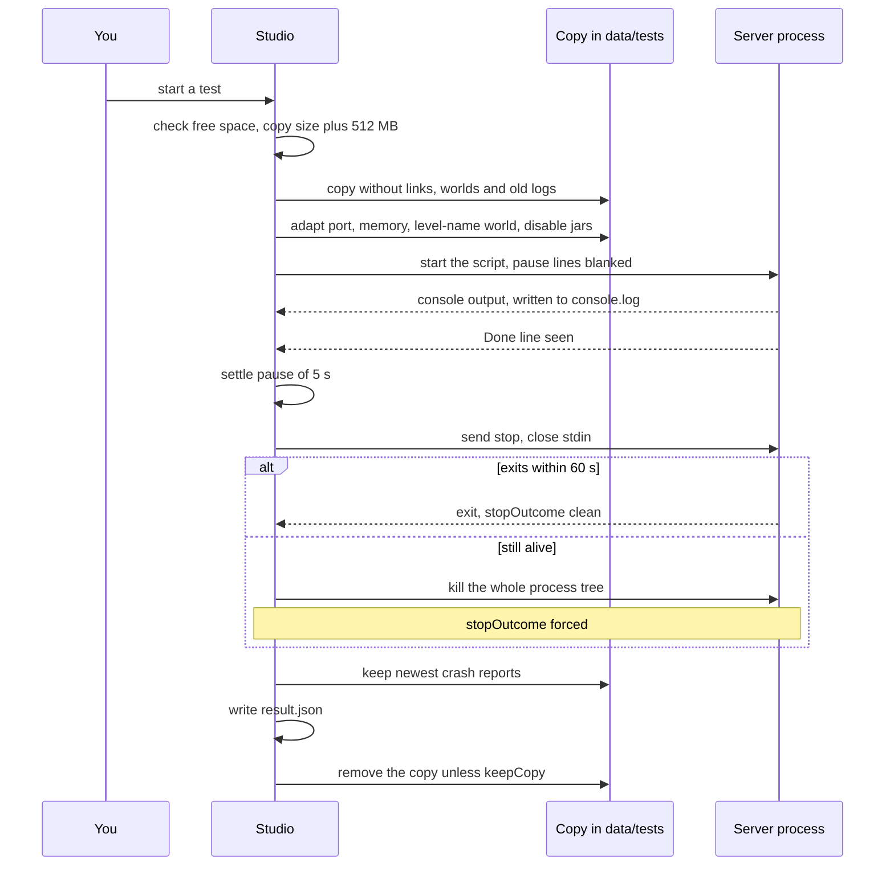
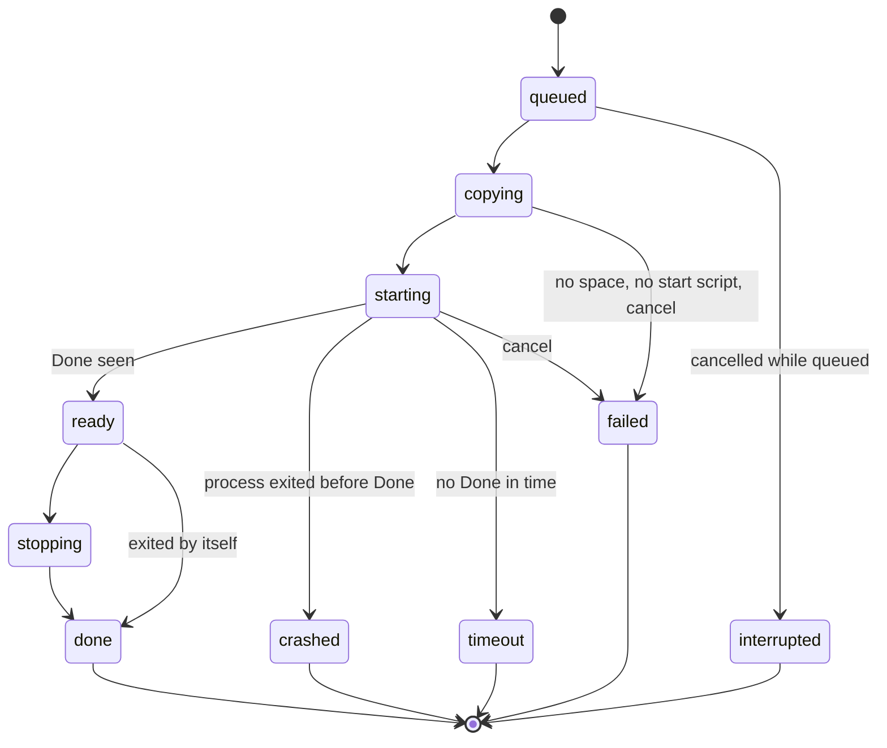

# Test bench

> Part of [Modpack Studio](../README.md) · created with Claude Code

**What this page covers:** how a server test runs on a throwaway copy, which options it takes, what the result and the run statuses mean, and what stays on disk afterwards.

Starts a **throwaway copy** of a server, waits for it to finish loading, stops it and keeps the logs. Your real server is never touched. One test runs at a time.

## Run

`POST /testbench/server` (job), `GET /testbench/runs[/:id[/log]]`, `POST /testbench/runs/:id/cancel`. Only a server profile stored as a folder or an SMB path can be tested; a zip profile gets 409.

The sequence below follows one run from the request to the cleanup.

1. **Free space** is checked first: the size of what will be copied plus a 512 MB margin must be available on the data disk. Otherwise the run fails early with `result.code` `not-enough-space` and a readable message.
2. **Copy** the server folder without the world. `level-name` is read from `server.properties`. Symlinks and junctions are never recreated in the copy (each one is noted in the log). Skipped entries:
   - top-level folders `logs`, `crash-reports`, `backups`, `cache`, `.git`, `dynmap`, `sdlinkstorage`;
   - the file `session.lock` and any top-level `*.log` file;
   - the worlds `world`, `world_nether`, `world_the_end` and the same three for the `level-name` folder (a world under a subfolder leaves only that world).
3. **Adapt the copy** (never the source):
   - port `25570` by default, `online-mode=false`, RCON off;
   - `level-name` forced to `world` inside the copy, so the test can never open the real world;
   - `user_jvm_args.txt` memory rewritten (no `AlwaysPreTouch`);
   - `.jar` files in `mods/` whose file name matches `discord`, `dcintegration`, `dynmap` or `bluemap` (case-insensitive) renamed `.jar.disabled`, so the usual chat bridge and map mods stay off. This is a name match, not a guarantee: a mod with another name stays active. The disabled jars are listed in `disabledMods` of the result.
   - standalone `pause` lines of the start script are blanked in the copy, so a wrapper cannot keep the process alive after Java is gone.
4. **EULA** is accepted in the copy only if you tick the checkbox or the source already accepted it.
5. **Start** through `run.bat` / `startserver.bat` / `start.bat`, then wait for `Done (x s)!`.
6. **Stop**: after a 5 s settle pause, send `stop` and close stdin. If the process is still alive after a 60 s grace period, the whole process tree is killed.
7. **Keep** `result.json`, `status.json`, `meta.json`, `console.log` and the newest crash reports (up to 20, 512 KB each, in `crash-reports/`) in `data/tests/<stamp>_<pack>-<version>-<state>/`. A `-2`, `-3` suffix is added when the id already exists.
8. **Remove the server copy** at the end of every run, failed ones included, unless the request sets `keepCopy: true`. Without it, a test leaves only the small files above on disk.

### Options

| Request field | Default | Limits |
|---|---|---|
| `profile` | required | a server profile (folder or SMB) |
| `acceptEula` | `false` | |
| `memoryMb` | 8192 | 1024 to 65536 |
| `port` | 25570 | 1024 to 65535 |
| `timeoutMin` | 10 | 1 to 60 (wait for `Done`) |
| `keepCopy` | `false` | keep the full copy for inspection |

`GET /testbench/runs/:id/log?tail=` returns the last lines of the console log (default 300, max 2000). The console log is capped at 64 MB; the summary still counts every line.

### Statuses

The diagram shows how a run moves between statuses. `done`, `failed`, `timeout`, `crashed` and `interrupted` are final.

| Status | Meaning |
|---|---|
| `done` | The server printed `Done`. Check `stopOutcome` |
| `crashed` | The process exited before `Done` |
| `timeout` | No `Done` within `timeoutMin` (the process is stopped) |
| `failed` | Could not copy or start, or cancelled while running (message `cancelled`) |
| `interrupted` | The job ended without writing a result: cancelled while queued, Studio restarted, or the job crashed. Settled when the run is read, and at startup |

`stopOutcome` in `result.json` tells how the process ended:

| `stopOutcome` | Meaning |
|---|---|
| `clean` | Exited by itself after `stop` |
| `forced` | Still alive after the 60 s grace period, process tree killed |
| `exited-early` | Gone before `stop` was sent (crash before `Done`, or exit during the settle pause: message "the server exited by itself after Done") |

The status stays `done` for a normal `Done` even when `stopOutcome` is `forced` or `exited-early`; the UI shows those two as warnings.

### Cancel

`POST /testbench/runs/:id/cancel` answers 409 with a code when it cannot cancel: `run-finished` (already finished), `no-job` (no job to cancel) or `job-not-live` (the job is no longer running). An unknown id gives 404 `run-not-found`. Cancelling a queued run closes it as `interrupted` at once.

## Analysis

The **Analyse with Claude** button builds a prompt from the run (result, crash report, log tail) and answers in plain language, through the API or as a prompt to paste ([Claude assistant](claude-assistant.md)). If the answer was cut short, the truncated text is shown with a warning.

## Not yet

A **client** test needs a launcher and a Minecraft account, which are not part of Studio. Options (offline accounts, headless launchers) are still a spike; see the [roadmap](roadmap.md).
