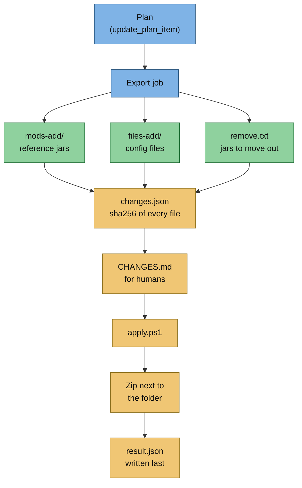
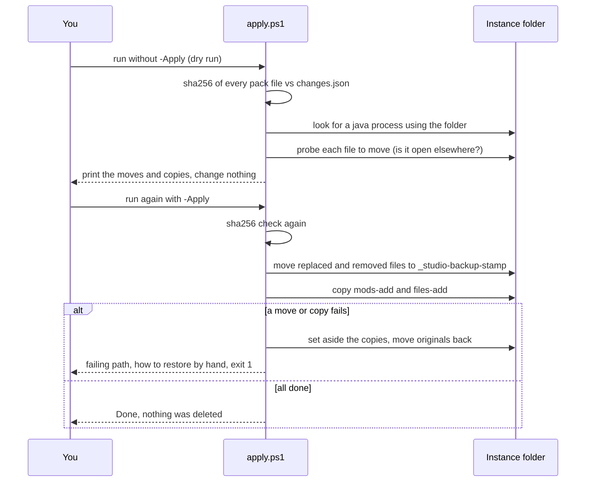

# Update packs

> Part of [Modpack Studio](../README.md) · created with Claude Code

**What this page covers:** how a plan becomes an update pack (folder and zip), what is inside, and how the bundled `apply.ps1` applies it to an instance without deleting anything.

## The plan

On the Mods tab each row that can take the reference jar has a toggle: **update** (older, different, rebuilt) or **put the mod back** (missing). Config files are chosen in the Configs tab ([Config analysis](configs-analysis.md)). The plan is stored per comparison (`PUT /plan`, table `update_plan_item`, kinds mod / file). **Ticking a row only saves the plan in Studio's database**: no instance and no export file is touched. Pins, accepted removals and client-only decisions appear as badges.

Plan and assistant routes refuse a client profile paired with a server profile (400, code `sides_differ`), so a pack is never built across sides.

## Export

**Prepare the update pack** (`POST /plan/export`, job `export-update-pack`) writes under `data/exports/update-<other>-from-<base>-<UTC stamp>/`. The pack is built in a `.partial` staging folder and renamed once complete; `result.json` is written last, so an export folder without it is incomplete and is never listed. Leftover `update-*.partial` folders and `update-*.zip.partial` files are deleted when the server starts.

The flow below shows what goes into a pack and in which order it is assembled.



| Path | Content |
|---|---|
| `mods-add/` | Reference jars, re-hashed and checked against the sha256 recorded at import (a mismatch or missing jar is reported, not copied) |
| `remove.txt` | The jars of the compared profile that must leave `mods/`, one name per line (see below) |
| `files-add/` | Planned config files, copied from the reference or, for customizations, from the played profile |
| `changes.json`, `CHANGES.md` | Machine and human readable change list, with failures and warnings |
| `apply.ps1` | Safe applier |
| `<name>.zip` | The pack folder zipped, next to it (not inside it) |
| `result.json` | Studio's completion marker and summary (counts, failures, folder). Written after the zip, so it is not in the zip and is not a change list |

Jars need not be imported when the plan contains only files.

### What `remove.txt` names

`remove.txt` names the file the target **really has**, not the name recorded at import. Studio looks the jar up in the target by name, then by size and sha256 (even under another name). The pack then carries a warning in `CHANGES.md` and `changes.json` when a jar:

- was renamed in the target (the new name is used),
- is missing from the target (the recorded name is kept, check the mods folder),
- could not be verified because the target location cannot be listed.

When the target holds two jars for one mod id, both go to `remove.txt` and a warning says so. A jar that provides other mods also produces a warning, because those leave with it. The reference jar is located the same way.

## Applying

Run the script from the unpacked pack folder. Use the same form as the generated `CHANGES.md`:

```powershell
powershell -ExecutionPolicy Bypass -File .\apply.ps1 -InstanceDir "D:\Instances\MyPack"          # dry run: checks every sha256, prints the changes
powershell -ExecutionPolicy Bypass -File .\apply.ps1 -InstanceDir "D:\Instances\MyPack" -Apply   # moves replaced/removed files to _studio-backup-<stamp>\, then copies
```

`-ExecutionPolicy Bypass` is there because Windows PowerShell 5.1 refuses unsigned scripts under its default policy, and a script from a downloaded zip carries a Mark-of-the-Web. It only affects that one command. Pass the folder **without a trailing backslash**: a backslash right before the closing quote escapes it, and the script then answers "instance folder not found" with a hint (nothing is changed). Works in Windows PowerShell 5.1 and PowerShell 7.

The sequence below is what the script does, in order. Nothing outside the instance folder and the pack is touched.



What the script guarantees:

- **Verify first.** The sha256 of every file of the pack is checked against `changes.json` before anything is touched. A mismatch, a missing file, an unsafe path or a file not listed stops the run.
- **Never deletes.** Replaced and removed files are moved into `<instance>\_studio-backup-<timestamp>\` with the same relative paths. To undo a successful run, move them back.
- **Rolls back on failure.** If a move or copy fails, the script sets the files it copied aside in `_copied-by-the-failed-run` inside the backup, moves the originals back, prints the failing path and exits 1. If something could not be restored it lists it and says how to restore by hand. After fixing the cause, running again is safe.
- **Refuses files in use.** Before the backup is created every file to move is probed. A file held open by another program stops the run with "in use ... nothing was changed". `-Force` does not bypass this.
- **Running-game guard, best effort.** The script lists `java.exe` and `javaw.exe` processes and tests whether their command line contains the instance folder (slashes, case and a trailing separator are normalised, and a sibling such as `MyPack-two` does not match). In a dry run a match only prints a warning. With `-Apply` and without `-Force` a match stops the run. A server started with relative paths does not show the folder in its command line and is not seen by this check, which is why the file-in-use probe backs it up. If the process list cannot be read, the script says so and continues. Close the game and the server yourself before applying.

Studio itself never writes into an instance. See [Security](security.md).
